# Stream-CQSA v3 experiments (experiments/v3/PLAN.md): report

Generated 2026-10-30 21:42 by `experiments/v3/bench.py report` from `results/v3/results.jsonl` (535 rows, 500 configurations; the last row per key). GPUs: NVIDIA A100 80GB PCIe, NVIDIA A100-SXM4-80GB. Jobs: 15966097, 16003186, 16005563, 16007771, 16011674, 16056869, 16057173, 16059599, 16061624, 16061811, 16063609, 16070367, 16072865, 16074280, 16074929, 16075878, 16077768, 16079116, 16079918, 16092420, 16094767, 16113653, 16115186, 16115960, 16116751, 16119471, 16328779, 16333022, 16334737, 16500372, 16500373. Modules: cqsa_cuda_v13 / cqsa_native_v2.

B=1 H=8 causal; wall = median of the timed runs (fwd: one attention() call; bwd: forward + torch.autograd.grad), min alongside; peak = torch.cuda.max_memory_allocated over the call, workspace = peak minus what was resident before it; host = VmHWM delta over the timed runs; /FA-2 and /SDPA = wall ratios against the resident monolithic baselines of the same (node type, N, D, dtype, direction) (the experiment's own first, E1's / E6's otherwise); ref = the reference arm of the row (FA-2 = flash_attn, or SDPA-flash = torch SDPA on its flash backend where flash_attn is not installed); rel = norm-relative error against that arm on the same inputs (grads: the worst of dq/dk/dv); fp64 = norm-relative error on 128 sampled rows against an fp64 reference, with the ratio to the reference arm's own fp64 error on the same rows in parentheses (PLAN.md asks <= 1.2). Every Stream-CQSA row pins itr and c and asserts the decomposition it reports; `[*]` marks an engine other than the series' nominal one (documented routing: the wave backward runs on the CUDA kernel and on device-resident inputs only, so wave_Triton fwd+bwd and host-resident wave backwards run on the classic engine; the wave backward keeps a device accumulator, so wave_CUDA acc=cpu fwd+bwd rows ran with acc=gpu in the backward).

## E0: correctness: every series and every (c, itr, acc) path is exact (output and gradients vs FA-2 and vs fp64)

| N | D | dtype | dir | c | itr | acc | qkv | W | arm | engine that ran | wall s | min s | peak GiB | workspace | host GiB | /FA-2 | /SDPA | ref | rel vs ref | grads | fp64 (x ref) | fp64 dq (x ref) | status |
|---|---|---|---|---|---|---|---|---|---|---|---|---|---|---|---|---|---|---|---|---|---|---|---|
| 256K | 64 | bf16 | fwd | 7 | 1 | gpu | device | - | classic_CUDA | classic/cuda itr=1 n_sub=7 | 0.400 | 0.400 | 2.38 | 1.62 | 0.02 | - | - | FA-2 | 1.0e-03 | - | 2.2e-04 (1.00) | - | ok |
| 256K | 64 | bf16 | fwd | 7 | 1 | gpu | device | - | wave_CUDA | wave/cuda itr=1 n_sub=7 waves=7 | 0.422 | 0.422 | 2.61 | 1.86 | 0.01 | - | - | FA-2 | 1.0e-03 | - | 2.2e-04 (1.00) | - | ok |
| 256K | 64 | bf16 | fwd | 7 | 1 | gpu | device | - | classic_Triton | classic/triton itr=1 n_sub=7 | 0.621 | 0.621 | 2.38 | 1.62 | 0.02 | - | - | FA-2 | 2.4e-03 | - | 2.2e-04 (1.00) | - | ok |
| 256K | 64 | bf16 | fwd | 7 | 1 | gpu | device | - | wave_Triton | wave/triton itr=1 n_sub=7 waves=7 | 2.176 | 2.176 | 3.12 | 2.36 | 0.06 | - | - | FA-2 | 2.4e-03 | - | 2.2e-04 (1.00) | - | ok |
| 256K | 64 | bf16 | bwd | 7 | 1 | gpu | device | - | classic_CUDA | classic/cuda itr=1 n_sub=7 | 1.396 | 1.396 | 4.78 | 3.77 | 0.02 | - | - | FA-2 | 1.0e-03 | 2.8e-03 | 2.2e-04 (1.00) | 2.6e-03 (1.08) | ok |
| 256K | 64 | bf16 | bwd | 7 | 1 | gpu | device | - | wave_CUDA | wave/cuda itr=1 n_sub=7 waves=7 | 1.427 | 1.427 | 5.00 | 3.99 | 0.01 | - | - | FA-2 | 1.0e-03 | 3.0e-03 | 2.2e-04 (1.00) | 2.6e-03 (1.08) | ok |
| 256K | 64 | bf16 | bwd | 7 | 1 | gpu | device | - | classic_Triton | classic/triton itr=1 n_sub=7 | 2.423 | 2.423 | 4.78 | 3.77 | 0.02 | - | - | FA-2 | 2.4e-03 | 2.9e-03 | 2.2e-04 (1.00) | 2.6e-03 (1.08) | ok |
| 256K | 64 | bf16 | bwd | 7 | 1 | gpu | device | - | wave_Triton | classic/triton itr=1 n_sub=7 | 2.422 | 2.422 | 4.78 | 3.77 | 0.02 | - | - | FA-2 | 2.4e-03 | 2.9e-03 | 2.2e-04 (1.00) | 2.6e-03 (1.08) | ok |
| 256K | 64 | fp16 | fwd | 3 | 1 | cpu | host | - | classic_CUDA | classic/cuda itr=1 n_sub=3 | 1.422 | 1.422 | 1.02 | 1.01 | 3.20 | 3.921 | 3.712 | FA-2 | 1.1e-04 | - | 2.7e-05 (0.96) | - | ok |
| 256K | 64 | fp16 | fwd | 3 | 1 | gpu | device | - | classic_CUDA | classic/cuda itr=1 n_sub=3 | 0.389 | 0.389 | 2.99 | 2.24 | 0.02 | 1.072 | 1.015 | FA-2 | 1.1e-04 | - | 2.7e-05 (0.96) | - | ok |
| 256K | 64 | fp16 | fwd | 3 | 2 | cpu | host | - | classic_CUDA | classic/cuda itr=2 n_sub=9 | 1.648 | 1.648 | 0.68 | 0.67 | 2.12 | 4.543 | 4.301 | FA-2 | 1.4e-04 | - | 2.7e-05 (0.94) | - | ok |
| 256K | 64 | fp16 | fwd | 3 | 2 | gpu | device | - | classic_CUDA | classic/cuda itr=2 n_sub=9 | 0.428 | 0.428 | 2.42 | 1.66 | 0.02 | 1.181 | 1.118 | FA-2 | 1.4e-04 | - | 2.7e-05 (0.94) | - | ok |
| 256K | 64 | fp16 | fwd | 7 | 1 | cpu | host | - | classic_CUDA | classic/cuda itr=1 n_sub=7 | 1.195 | 1.195 | 0.66 | 0.65 | 2.07 | 3.294 | 3.118 | FA-2 | 1.5e-04 | - | 2.7e-05 (0.94) | - | ok |
| 256K | 64 | fp16 | fwd | 7 | 1 | gpu | device | - | classic_CUDA | classic/cuda itr=1 n_sub=7 | 0.402 | 0.402 | 2.38 | 1.62 | 0.02 | 1.108 | 1.049 | FA-2 | 1.5e-04 | - | 2.7e-05 (0.94) | - | ok |
| 256K | 64 | fp16 | fwd | 7 | 2 | cpu | host | - | classic_CUDA | classic/cuda itr=2 n_sub=49 | 2.944 | 2.944 | 0.29 | 0.28 | 1.79 | 8.115 | 7.683 | FA-2 | 1.9e-04 | - | 2.6e-05 (0.93) | - | ok |
| 256K | 64 | fp16 | fwd | 7 | 2 | gpu | device | - | classic_CUDA | classic/cuda itr=2 n_sub=49 | 0.559 | 0.559 | 1.80 | 1.04 | 0.05 | 1.541 | 1.459 | FA-2 | 1.9e-04 | - | 2.6e-05 (0.93) | - | ok |
| 256K | 64 | fp16 | fwd | 31 | 1 | cpu | host | - | classic_CUDA | classic/cuda itr=1 n_sub=31 | 1.936 | 1.936 | 0.45 | 0.44 | 1.74 | 5.337 | 5.052 | FA-2 | 2.0e-04 | - | 2.6e-05 (0.92) | - | ok |
| 256K | 64 | fp16 | fwd | 31 | 1 | gpu | device | - | classic_CUDA | classic/cuda itr=1 n_sub=31 | 0.467 | 0.467 | 1.80 | 1.04 | 0.03 | 1.287 | 1.218 | FA-2 | 2.0e-04 | - | 2.6e-05 (0.92) | - | ok |
| 256K | 64 | fp16 | fwd | 31 | 2 | cpu | host | - | classic_CUDA | classic/cuda itr=2 n_sub=961 | 11.737 | 11.737 | 0.07 | 0.06 | 1.53 | 32.352 | 30.629 | FA-2 | 2.5e-04 | - | 2.6e-05 (0.92) | - | ok |
| 256K | 64 | fp16 | fwd | 31 | 2 | gpu | device | - | classic_CUDA | classic/cuda itr=2 n_sub=961 | 1.987 | 1.987 | 1.80 | 1.04 | 0.25 | 5.476 | 5.185 | FA-2 | 2.5e-04 | - | 2.6e-05 (0.92) | - | ok |
| 256K | 64 | fp16 | fwd | 133 | 1 | cpu | host | - | classic_CUDA | classic/cuda itr=1 n_sub=133 | 3.671 | 3.671 | 0.22 | 0.21 | 1.45 | 10.119 | 9.580 | FA-2 | 2.4e-04 | - | 2.6e-05 (0.91) | - | ok |
| 256K | 64 | fp16 | fwd | 133 | 1 | gpu | device | - | classic_CUDA | classic/cuda itr=1 n_sub=133 | 0.656 | 0.656 | 1.80 | 1.04 | 0.07 | 1.807 | 1.711 | FA-2 | 2.4e-04 | - | 2.6e-05 (0.91) | - | ok |
| 256K | 64 | fp16 | fwd | 3 | 1 | cpu | host | - | wave_CUDA | wave/cuda itr=1 n_sub=3 waves=3 | 1.332 | 1.332 | 1.45 | 1.44 | 2.90 | 3.672 | 3.476 | FA-2 | 1.1e-04 | - | 2.7e-05 (0.96) | - | ok |
| 256K | 64 | fp16 | fwd | 3 | 1 | gpu | device | - | wave_CUDA | wave/cuda itr=1 n_sub=3 waves=3 | 0.403 | 0.403 | 2.96 | 2.20 | 0.01 | 1.112 | 1.053 | FA-2 | 1.1e-04 | - | 2.7e-05 (0.96) | - | ok |
| 256K | 64 | fp16 | fwd | 3 | 2 | cpu | host | - | wave_CUDA | wave/cuda itr=2 n_sub=9 waves=9 | 1.133 | 1.133 | 1.22 | 1.21 | 2.37 | 3.124 | 2.958 | FA-2 | 1.4e-04 | - | 2.7e-05 (0.94) | - | ok |
| 256K | 64 | fp16 | fwd | 3 | 2 | gpu | device | - | wave_CUDA | wave/cuda itr=2 n_sub=9 waves=9 | 0.453 | 0.453 | 2.63 | 1.87 | 0.02 | 1.247 | 1.181 | FA-2 | 1.4e-04 | - | 2.7e-05 (0.94) | - | ok |
| 256K | 64 | fp16 | fwd | 7 | 1 | cpu | host | - | wave_CUDA | wave/cuda itr=1 n_sub=7 waves=7 | 1.059 | 1.059 | 1.20 | 1.20 | 2.24 | 2.919 | 2.764 | FA-2 | 1.5e-04 | - | 2.7e-05 (0.94) | - | ok |
| 256K | 64 | fp16 | fwd | 7 | 1 | gpu | device | - | wave_CUDA | wave/cuda itr=1 n_sub=7 waves=7 | 0.423 | 0.423 | 2.61 | 1.86 | 0.01 | 1.166 | 1.104 | FA-2 | 1.5e-04 | - | 2.7e-05 (0.94) | - | ok |
| 256K | 64 | fp16 | fwd | 7 | 2 | cpu | host | - | wave_CUDA | wave/cuda itr=2 n_sub=49 waves=10 | 1.510 | 1.510 | 1.56 | 1.55 | 2.81 | 4.161 | 3.939 | FA-2 | 1.9e-04 | - | 2.6e-05 (0.93) | - | ok |
| 256K | 64 | fp16 | fwd | 7 | 2 | gpu | device | - | wave_CUDA | wave/cuda itr=2 n_sub=49 waves=10 | 0.556 | 0.556 | 3.41 | 2.65 | 0.04 | 1.533 | 1.452 | FA-2 | 1.9e-04 | - | 2.6e-05 (0.93) | - | ok |
| 256K | 64 | fp16 | fwd | 31 | 1 | cpu | host | - | wave_CUDA | wave/cuda itr=1 n_sub=31 waves=7 | 1.347 | 1.347 | 1.64 | 1.63 | 2.79 | 3.714 | 3.516 | FA-2 | 2.0e-04 | - | 2.6e-05 (0.92) | - | ok |
| 256K | 64 | fp16 | fwd | 31 | 1 | gpu | device | - | wave_CUDA | wave/cuda itr=1 n_sub=31 waves=7 | 0.475 | 0.475 | 3.49 | 2.73 | 0.02 | 1.309 | 1.239 | FA-2 | 2.0e-04 | - | 2.6e-05 (0.92) | - | ok |
| 256K | 64 | fp16 | fwd | 31 | 2 | cpu | host | - | wave_CUDA | wave/cuda itr=2 n_sub=961 waves=37 | 2.614 | 2.614 | 1.47 | 1.46 | 2.27 | 7.205 | 6.821 | FA-2 | 2.5e-04 | - | 2.6e-05 (0.92) | - | ok |
| 256K | 64 | fp16 | fwd | 31 | 2 | gpu | device | - | wave_CUDA | wave/cuda itr=2 n_sub=961 waves=37 | 1.520 | 1.520 | 3.53 | 2.77 | 0.14 | 4.189 | 3.966 | FA-2 | 2.5e-04 | - | 2.6e-05 (0.92) | - | ok |
| 256K | 64 | fp16 | fwd | 133 | 1 | cpu | host | - | wave_CUDA | wave/cuda itr=1 n_sub=133 waves=13 | 1.800 | 1.800 | 1.64 | 1.63 | 2.72 | 4.963 | 4.699 | FA-2 | 2.4e-04 | - | 2.6e-05 (0.91) | - | ok |
| 256K | 64 | fp16 | fwd | 133 | 1 | gpu | device | - | wave_CUDA | wave/cuda itr=1 n_sub=133 waves=13 | 0.624 | 0.624 | 3.54 | 2.78 | 0.05 | 1.719 | 1.628 | FA-2 | 2.4e-04 | - | 2.6e-05 (0.91) | - | ok |
| 256K | 64 | fp16 | fwd | 3 | 1 | cpu | host | - | classic_Triton | classic/triton itr=1 n_sub=3 | 1.731 | 1.731 | 0.85 | 0.84 | 3.20 | 4.772 | 4.518 | FA-2 | 3.2e-04 | - | 2.7e-05 (0.96) | - | ok |
| 256K | 64 | fp16 | fwd | 3 | 1 | gpu | device | - | classic_Triton | classic/triton itr=1 n_sub=3 | 0.595 | 0.595 | 2.99 | 2.24 | 0.02 | 1.641 | 1.553 | FA-2 | 3.2e-04 | - | 2.7e-05 (0.96) | - | ok |
| 256K | 64 | fp16 | fwd | 3 | 2 | cpu | host | - | classic_Triton | classic/triton itr=2 n_sub=9 | 1.796 | 1.796 | 0.57 | 0.56 | 2.12 | 4.950 | 4.686 | FA-2 | 3.2e-04 | - | 2.7e-05 (0.94) | - | ok |
| 256K | 64 | fp16 | fwd | 3 | 2 | gpu | device | - | classic_Triton | classic/triton itr=2 n_sub=9 | 0.643 | 0.643 | 2.42 | 1.66 | 0.02 | 1.773 | 1.679 | FA-2 | 3.2e-04 | - | 2.7e-05 (0.94) | - | ok |
| 256K | 64 | fp16 | fwd | 7 | 1 | cpu | host | - | classic_Triton | classic/triton itr=1 n_sub=7 | 1.591 | 1.591 | 0.55 | 0.54 | 2.07 | 4.385 | 4.152 | FA-2 | 3.2e-04 | - | 2.7e-05 (0.94) | - | ok |
| 256K | 64 | fp16 | fwd | 7 | 1 | gpu | device | - | classic_Triton | classic/triton itr=1 n_sub=7 | 0.621 | 0.621 | 2.38 | 1.62 | 0.02 | 1.712 | 1.621 | FA-2 | 3.2e-04 | - | 2.7e-05 (0.94) | - | ok |
| 256K | 64 | fp16 | fwd | 7 | 2 | cpu | host | - | classic_Triton | classic/triton itr=2 n_sub=49 | 2.924 | 2.924 | 0.24 | 0.24 | 1.76 | 8.060 | 7.631 | FA-2 | 3.2e-04 | - | 2.6e-05 (0.93) | - | ok |
| 256K | 64 | fp16 | fwd | 7 | 2 | gpu | device | - | classic_Triton | classic/triton itr=2 n_sub=49 | 0.843 | 0.843 | 1.80 | 1.04 | 0.05 | 2.325 | 2.201 | FA-2 | 3.2e-04 | - | 2.6e-05 (0.93) | - | ok |
| 256K | 64 | fp16 | fwd | 31 | 1 | cpu | host | - | classic_Triton | classic/triton itr=1 n_sub=31 | 2.048 | 2.048 | 0.25 | 0.25 | 1.75 | 5.646 | 5.345 | FA-2 | 3.2e-04 | - | 2.6e-05 (0.93) | - | ok |
| 256K | 64 | fp16 | fwd | 31 | 1 | gpu | device | - | classic_Triton | classic/triton itr=1 n_sub=31 | 0.745 | 0.745 | 1.80 | 1.04 | 0.03 | 2.055 | 1.945 | FA-2 | 3.2e-04 | - | 2.6e-05 (0.93) | - | ok |
| 256K | 64 | fp16 | fwd | 31 | 2 | cpu | host | - | classic_Triton | classic/triton itr=2 n_sub=961 | 11.753 | 11.753 | 0.06 | 0.05 | 1.46 | 32.396 | 30.671 | FA-2 | 3.2e-04 | - | 2.6e-05 (0.91) | - | ok |
| 256K | 64 | fp16 | fwd | 31 | 2 | gpu | device | - | classic_Triton | classic/triton itr=2 n_sub=961 | 4.311 | 4.311 | 1.80 | 1.04 | 0.25 | 11.883 | 11.250 | FA-2 | 3.2e-04 | - | 2.6e-05 (0.91) | - | ok |
| 256K | 64 | fp16 | fwd | 133 | 1 | cpu | host | - | classic_Triton | classic/triton itr=1 n_sub=133 | 3.865 | 3.865 | 0.13 | 0.12 | 1.46 | 10.655 | 10.088 | FA-2 | 3.2e-04 | - | 2.6e-05 (0.92) | - | ok |
| 256K | 64 | fp16 | fwd | 133 | 1 | gpu | device | - | classic_Triton | classic/triton itr=1 n_sub=133 | 1.324 | 1.324 | 1.80 | 1.04 | 0.07 | 3.650 | 3.456 | FA-2 | 3.2e-04 | - | 2.6e-05 (0.92) | - | ok |
| 256K | 64 | fp16 | fwd | 3 | 1 | cpu | host | - | wave_Triton | wave/triton itr=1 n_sub=3 waves=3 | 1.723 | 1.723 | 3.19 | 3.18 | 2.90 | 4.750 | 4.497 | FA-2 | 3.2e-04 | - | 2.7e-05 (0.96) | - | ok |
| 256K | 64 | fp16 | fwd | 3 | 1 | gpu | device | - | wave_Triton | wave/triton itr=1 n_sub=3 waves=3 | 0.621 | 0.621 | 3.86 | 3.10 | 0.01 | 1.711 | 1.619 | FA-2 | 3.2e-04 | - | 2.7e-05 (0.96) | - | ok |
| 256K | 64 | fp16 | fwd | 3 | 2 | cpu | host | - | wave_Triton | wave/triton itr=2 n_sub=9 waves=9 | 1.386 | 1.386 | 2.38 | 2.37 | 2.38 | 3.819 | 3.616 | FA-2 | 3.2e-04 | - | 2.7e-05 (0.94) | - | ok |
| 256K | 64 | fp16 | fwd | 3 | 2 | gpu | device | - | wave_Triton | wave/triton itr=2 n_sub=9 waves=9 | 0.682 | 0.682 | 3.17 | 2.41 | 0.02 | 1.881 | 1.781 | FA-2 | 3.2e-04 | - | 2.7e-05 (0.94) | - | ok |
| 256K | 64 | fp16 | fwd | 7 | 1 | cpu | host | - | wave_Triton | wave/triton itr=1 n_sub=7 waves=7 | 1.496 | 1.496 | 2.32 | 2.31 | 2.24 | 4.124 | 3.905 | FA-2 | 3.2e-04 | - | 2.7e-05 (0.94) | - | ok |
| 256K | 64 | fp16 | fwd | 7 | 1 | gpu | device | - | wave_Triton | wave/triton itr=1 n_sub=7 waves=7 | 0.656 | 0.656 | 3.12 | 2.36 | 0.01 | 1.810 | 1.713 | FA-2 | 3.2e-04 | - | 2.7e-05 (0.94) | - | ok |
| 256K | 64 | fp16 | fwd | 7 | 2 | cpu | host | - | wave_Triton | wave/triton itr=2 n_sub=49 waves=10 | 1.779 | 1.779 | 4.06 | 4.05 | 2.82 | 4.903 | 4.642 | FA-2 | 3.2e-04 | - | 2.6e-05 (0.93) | - | ok |
| 256K | 64 | fp16 | fwd | 7 | 2 | gpu | device | - | wave_Triton | wave/triton itr=2 n_sub=49 waves=10 | 0.826 | 0.826 | 4.79 | 4.03 | 0.04 | 2.276 | 2.155 | FA-2 | 3.2e-04 | - | 2.6e-05 (0.93) | - | ok |
| 256K | 64 | fp16 | fwd | 31 | 1 | cpu | host | - | wave_Triton | wave/triton itr=1 n_sub=31 waves=7 | 1.639 | 1.639 | 4.70 | 4.69 | 2.80 | 4.517 | 4.277 | FA-2 | 3.2e-04 | - | 2.6e-05 (0.93) | - | ok |
| 256K | 64 | fp16 | fwd | 31 | 1 | gpu | device | - | wave_Triton | wave/triton itr=1 n_sub=31 waves=7 | 0.735 | 0.735 | 5.34 | 4.59 | 0.02 | 2.025 | 1.917 | FA-2 | 3.2e-04 | - | 2.6e-05 (0.93) | - | ok |
| 256K | 64 | fp16 | fwd | 31 | 2 | cpu | host | - | wave_Triton | wave/triton itr=2 n_sub=961 waves=37 | 2.918 | 2.918 | 4.71 | 4.70 | 2.28 | 8.042 | 7.614 | FA-2 | 3.2e-04 | - | 2.6e-05 (0.91) | - | ok |
| 256K | 64 | fp16 | fwd | 31 | 2 | gpu | device | - | wave_Triton | wave/triton itr=2 n_sub=961 waves=37 | 1.937 | 1.937 | 5.54 | 4.78 | 0.15 | 5.340 | 5.056 | FA-2 | 3.2e-04 | - | 2.6e-05 (0.91) | - | ok |
| 256K | 64 | fp16 | fwd | 133 | 1 | cpu | host | - | wave_Triton | wave/triton itr=1 n_sub=133 waves=13 | 2.020 | 2.020 | 4.47 | 4.46 | 2.72 | 5.569 | 5.272 | FA-2 | 3.2e-04 | - | 2.6e-05 (0.92) | - | ok |
| 256K | 64 | fp16 | fwd | 133 | 1 | gpu | device | - | wave_Triton | wave/triton itr=1 n_sub=133 waves=13 | 0.923 | 0.923 | 5.13 | 4.37 | 0.05 | 2.543 | 2.408 | FA-2 | 3.2e-04 | - | 2.6e-05 (0.92) | - | ok |
| 256K | 64 | fp16 | bwd | 3 | 1 | cpu | host | - | classic_CUDA | classic/cuda itr=1 n_sub=3 | 3.673 | 3.673 | 2.19 | 2.18 | 5.73 | 2.815 | 2.619 | FA-2 | 1.1e-04 | 3.6e-04 | 2.7e-05 (0.96) | 3.2e-04 (1.05) | ok |
| 256K | 64 | fp16 | bwd | 3 | 1 | gpu | device | - | classic_CUDA | classic/cuda itr=1 n_sub=3 | 1.368 | 1.368 | 5.61 | 4.60 | 0.02 | 1.048 | 0.975 | FA-2 | 1.1e-04 | 3.6e-04 | 2.7e-05 (0.96) | 3.2e-04 (1.05) | ok |
| 256K | 64 | fp16 | bwd | 3 | 2 | cpu | host | - | classic_CUDA | classic/cuda itr=2 n_sub=9 | 3.951 | 3.951 | 1.46 | 1.46 | 4.36 | 3.028 | 2.817 | FA-2 | 1.4e-04 | 3.6e-04 | 2.7e-05 (0.94) | 3.3e-04 (1.06) | ok |
| 256K | 64 | fp16 | bwd | 3 | 2 | gpu | device | - | classic_CUDA | classic/cuda itr=2 n_sub=9 | 1.452 | 1.452 | 4.83 | 3.82 | 0.03 | 1.113 | 1.035 | FA-2 | 1.4e-04 | 3.6e-04 | 2.7e-05 (0.94) | 3.3e-04 (1.06) | ok |
| 256K | 64 | fp16 | bwd | 7 | 1 | cpu | host | - | classic_CUDA | classic/cuda itr=1 n_sub=7 | 3.456 | 3.456 | 1.41 | 1.40 | 4.41 | 2.649 | 2.464 | FA-2 | 1.5e-04 | 3.6e-04 | 2.7e-05 (0.94) | 3.3e-04 (1.08) | ok |
| 256K | 64 | fp16 | bwd | 7 | 1 | gpu | device | - | classic_CUDA | classic/cuda itr=1 n_sub=7 | 1.403 | 1.403 | 4.78 | 3.77 | 0.02 | 1.075 | 1.000 | FA-2 | 1.5e-04 | 3.6e-04 | 2.7e-05 (0.94) | 3.3e-04 (1.08) | ok |
| 256K | 64 | fp16 | bwd | 7 | 2 | cpu | host | - | classic_CUDA | classic/cuda itr=2 n_sub=49 | 6.218 | 6.218 | 0.62 | 0.61 | 3.90 | 4.766 | 4.433 | FA-2 | 1.9e-04 | 3.6e-04 | 2.6e-05 (0.93) | 3.4e-04 (1.10) | ok |
| 256K | 64 | fp16 | bwd | 7 | 2 | gpu | device | - | classic_CUDA | classic/cuda itr=2 n_sub=49 | 1.685 | 1.685 | 4.02 | 3.01 | 0.05 | 1.291 | 1.201 | FA-2 | 1.9e-04 | 3.6e-04 | 2.6e-05 (0.93) | 3.4e-04 (1.10) | ok |
| 256K | 64 | fp16 | bwd | 31 | 1 | cpu | host | - | classic_CUDA | classic/cuda itr=1 n_sub=31 | 4.500 | 4.500 | 0.65 | 0.64 | 4.03 | 3.449 | 3.208 | FA-2 | 2.0e-04 | 3.6e-04 | 2.6e-05 (0.92) | 3.5e-04 (1.13) | ok |
| 256K | 64 | fp16 | bwd | 31 | 1 | gpu | device | - | classic_CUDA | classic/cuda itr=1 n_sub=31 | 1.525 | 1.525 | 4.02 | 3.01 | 0.03 | 1.169 | 1.087 | FA-2 | 2.0e-04 | 3.6e-04 | 2.6e-05 (0.92) | 3.5e-04 (1.13) | ok |
| 256K | 64 | fp16 | bwd | 31 | 2 | cpu | host | - | classic_CUDA | classic/cuda itr=2 n_sub=961 | 21.255 | 21.255 | 0.14 | 0.13 | 3.46 | 16.291 | 15.153 | FA-2 | 2.5e-04 | 3.6e-04 | 2.6e-05 (0.92) | 3.8e-04 (1.24) | ok |
| 256K | 64 | fp16 | bwd | 31 | 2 | gpu | device | - | classic_CUDA | classic/cuda itr=2 n_sub=961 | 4.252 | 4.252 | 4.02 | 3.01 | 0.25 | 3.259 | 3.032 | FA-2 | 2.5e-04 | 3.6e-04 | 2.6e-05 (0.92) | 3.8e-04 (1.24) | ok |
| 256K | 64 | fp16 | bwd | 133 | 1 | cpu | host | - | classic_CUDA | classic/cuda itr=1 n_sub=133 | 7.721 | 7.721 | 0.31 | 0.31 | 3.53 | 5.918 | 5.504 | FA-2 | 2.4e-04 | 3.6e-04 | 2.6e-05 (0.91) | 3.7e-04 (1.21) | ok |
| 256K | 64 | fp16 | bwd | 133 | 1 | gpu | device | - | classic_CUDA | classic/cuda itr=1 n_sub=133 | 1.847 | 1.847 | 4.02 | 3.01 | 0.07 | 1.416 | 1.317 | FA-2 | 2.4e-04 | 3.6e-04 | 2.6e-05 (0.91) | 3.8e-04 (1.21) | ok |
| 256K | 64 | fp16 | bwd | 3 | 1 | cpu | host | - | wave_CUDA | classic/cuda itr=1 n_sub=3 | 4.283 | 4.283 | 2.19 | 2.18 | 5.87 | 3.283 | 3.053 | FA-2 | 1.1e-04 | 3.6e-04 | 2.7e-05 (0.96) | 3.2e-04 (1.05) | ok |
| 256K | 64 | fp16 | bwd | 3 | 1 | gpu | device | - | wave_CUDA | wave/cuda itr=1 n_sub=3 waves=3 | 1.392 | 1.392 | 5.55 | 4.54 | 0.01 | 1.067 | 0.992 | FA-2 | 1.1e-04 | 3.7e-04 | 2.7e-05 (0.96) | 3.2e-04 (1.04) | ok |
| 256K | 64 | fp16 | bwd | 3 | 2 | cpu | host | - | wave_CUDA | classic/cuda itr=2 n_sub=9 | 4.467 | 4.467 | 1.46 | 1.46 | 4.56 | 3.424 | 3.185 | FA-2 | 1.4e-04 | 3.6e-04 | 2.7e-05 (0.94) | 3.3e-04 (1.06) | ok |
| 256K | 64 | fp16 | bwd | 3 | 2 | gpu | device | - | wave_CUDA | wave/cuda itr=2 n_sub=9 waves=9 | 1.490 | 1.490 | 5.04 | 4.03 | 0.02 | 1.142 | 1.062 | FA-2 | 1.4e-04 | 3.8e-04 | 2.7e-05 (0.94) | 3.2e-04 (1.05) | ok |
| 256K | 64 | fp16 | bwd | 7 | 1 | cpu | host | - | wave_CUDA | classic/cuda itr=1 n_sub=7 | 4.316 | 4.316 | 1.41 | 1.40 | 4.59 | 3.308 | 3.077 | FA-2 | 1.5e-04 | 3.6e-04 | 2.7e-05 (0.94) | 3.3e-04 (1.08) | ok |
| 256K | 64 | fp16 | bwd | 7 | 1 | gpu | device | - | wave_CUDA | wave/cuda itr=1 n_sub=7 waves=7 | 1.433 | 1.433 | 5.00 | 3.99 | 0.01 | 1.099 | 1.022 | FA-2 | 1.5e-04 | 3.8e-04 | 2.7e-05 (0.94) | 3.3e-04 (1.07) | ok |
| 256K | 64 | fp16 | bwd | 7 | 2 | cpu | host | - | wave_CUDA | classic/cuda itr=2 n_sub=49 | 6.169 | 6.169 | 0.62 | 0.61 | 4.04 | 4.728 | 4.398 | FA-2 | 1.9e-04 | 3.6e-04 | 2.6e-05 (0.93) | 3.4e-04 (1.10) | ok |
| 256K | 64 | fp16 | bwd | 7 | 2 | gpu | device | - | wave_CUDA | wave/cuda itr=2 n_sub=49 waves=10 | 1.655 | 1.655 | 6.13 | 5.12 | 0.04 | 1.269 | 1.180 | FA-2 | 1.9e-04 | 3.8e-04 | 2.6e-05 (0.93) | 3.4e-04 (1.09) | ok |
| 256K | 64 | fp16 | bwd | 31 | 1 | cpu | host | - | wave_CUDA | classic/cuda itr=1 n_sub=31 | 4.537 | 4.537 | 0.65 | 0.64 | 4.02 | 3.478 | 3.235 | FA-2 | 2.0e-04 | 3.6e-04 | 2.6e-05 (0.92) | 3.5e-04 (1.13) | ok |
| 256K | 64 | fp16 | bwd | 31 | 1 | gpu | device | - | wave_CUDA | wave/cuda itr=1 n_sub=31 waves=7 | 1.530 | 1.530 | 6.24 | 5.23 | 0.03 | 1.173 | 1.091 | FA-2 | 2.0e-04 | 3.8e-04 | 2.6e-05 (0.92) | 3.5e-04 (1.12) | ok |
| 256K | 64 | fp16 | bwd | 31 | 2 | cpu | host | - | wave_CUDA | classic/cuda itr=2 n_sub=961 | 20.663 | 20.663 | 0.14 | 0.13 | 3.73 | 15.837 | 14.731 | FA-2 | 2.5e-04 | 3.6e-04 | 2.6e-05 (0.92) | 3.8e-04 (1.24) | ok |
| 256K | 64 | fp16 | bwd | 31 | 2 | gpu | device | - | wave_CUDA | wave/cuda itr=2 n_sub=961 waves=37 | 3.170 | 3.170 | 6.29 | 5.28 | 0.15 | 2.430 | 2.260 | FA-2 | 2.5e-04 | 3.8e-04 | 2.6e-05 (0.92) | 3.8e-04 (1.23) | ok |
| 256K | 64 | fp16 | bwd | 133 | 1 | cpu | host | - | wave_CUDA | classic/cuda itr=1 n_sub=133 | 7.778 | 7.778 | 0.31 | 0.31 | 3.66 | 5.962 | 5.545 | FA-2 | 2.4e-04 | 3.6e-04 | 2.6e-05 (0.91) | 3.7e-04 (1.21) | ok |
| 256K | 64 | fp16 | bwd | 133 | 1 | gpu | device | - | wave_CUDA | wave/cuda itr=1 n_sub=133 waves=13 | 1.787 | 1.787 | 6.32 | 5.31 | 0.06 | 1.370 | 1.274 | FA-2 | 2.4e-04 | 3.7e-04 | 2.6e-05 (0.91) | 3.7e-04 (1.21) | ok |
| 256K | 64 | fp16 | bwd | 3 | 1 | cpu | host | - | classic_Triton | classic/triton itr=1 n_sub=3 | 5.332 | 5.332 | 2.35 | 2.34 | 5.73 | 4.087 | 3.801 | FA-2 | 3.2e-04 | 5.6e-04 | 2.7e-05 (0.96) | 3.3e-04 (1.07) | ok |
| 256K | 64 | fp16 | bwd | 3 | 1 | gpu | device | - | classic_Triton | classic/triton itr=1 n_sub=3 | 2.369 | 2.369 | 5.61 | 4.60 | 0.02 | 1.815 | 1.689 | FA-2 | 3.2e-04 | 5.6e-04 | 2.7e-05 (0.96) | 3.3e-04 (1.07) | ok |
| 256K | 64 | fp16 | bwd | 3 | 2 | cpu | host | - | classic_Triton | classic/triton itr=2 n_sub=9 | 4.948 | 4.948 | 1.57 | 1.56 | 4.34 | 3.793 | 3.528 | FA-2 | 3.2e-04 | 4.6e-04 | 2.7e-05 (0.94) | 3.3e-04 (1.07) | ok |
| 256K | 64 | fp16 | bwd | 3 | 2 | gpu | device | - | classic_Triton | classic/triton itr=2 n_sub=9 | 2.477 | 2.477 | 4.83 | 3.82 | 0.02 | 1.898 | 1.766 | FA-2 | 3.2e-04 | 4.6e-04 | 2.7e-05 (0.94) | 3.3e-04 (1.07) | ok |
| 256K | 64 | fp16 | bwd | 7 | 1 | cpu | host | - | classic_Triton | classic/triton itr=1 n_sub=7 | 4.497 | 4.497 | 1.52 | 1.51 | 4.39 | 3.446 | 3.206 | FA-2 | 3.2e-04 | 4.5e-04 | 2.7e-05 (0.94) | 3.4e-04 (1.09) | ok |
| 256K | 64 | fp16 | bwd | 7 | 1 | gpu | device | - | classic_Triton | classic/triton itr=1 n_sub=7 | 2.423 | 2.423 | 4.78 | 3.77 | 0.02 | 1.857 | 1.727 | FA-2 | 3.2e-04 | 4.5e-04 | 2.7e-05 (0.94) | 3.4e-04 (1.09) | ok |
| 256K | 64 | fp16 | bwd | 7 | 2 | cpu | host | - | classic_Triton | classic/triton itr=2 n_sub=49 | 7.356 | 7.356 | 0.66 | 0.65 | 3.90 | 5.638 | 5.244 | FA-2 | 3.2e-04 | 3.8e-04 | 2.6e-05 (0.93) | 3.4e-04 (1.10) | ok |
| 256K | 64 | fp16 | bwd | 7 | 2 | gpu | device | - | classic_Triton | classic/triton itr=2 n_sub=49 | 2.921 | 2.921 | 4.02 | 3.01 | 0.05 | 2.239 | 2.082 | FA-2 | 3.2e-04 | 3.8e-04 | 2.6e-05 (0.93) | 3.4e-04 (1.10) | ok |
| 256K | 64 | fp16 | bwd | 31 | 1 | cpu | host | - | classic_Triton | classic/triton itr=1 n_sub=31 | 5.467 | 5.467 | 0.69 | 0.69 | 3.82 | 4.190 | 3.898 | FA-2 | 3.2e-04 | 3.8e-04 | 2.6e-05 (0.93) | 3.5e-04 (1.13) | ok |
| 256K | 64 | fp16 | bwd | 31 | 1 | gpu | device | - | classic_Triton | classic/triton itr=1 n_sub=31 | 2.718 | 2.718 | 4.02 | 3.01 | 0.03 | 2.083 | 1.938 | FA-2 | 3.2e-04 | 3.8e-04 | 2.6e-05 (0.93) | 3.5e-04 (1.13) | ok |
| 256K | 64 | fp16 | bwd | 31 | 2 | cpu | host | - | classic_Triton | classic/triton itr=2 n_sub=961 | 27.182 | 27.182 | 0.15 | 0.14 | 3.47 | 20.834 | 19.378 | FA-2 | 3.2e-04 | 3.7e-04 | 2.6e-05 (0.91) | 3.8e-04 (1.24) | ok |
| 256K | 64 | fp16 | bwd | 31 | 2 | gpu | device | - | classic_Triton | classic/triton itr=2 n_sub=961 | 11.335 | 11.335 | 4.02 | 3.01 | 0.25 | 8.688 | 8.081 | FA-2 | 3.2e-04 | 3.7e-04 | 2.6e-05 (0.91) | 3.8e-04 (1.24) | ok |
| 256K | 64 | fp16 | bwd | 133 | 1 | cpu | host | - | classic_Triton | classic/triton itr=1 n_sub=133 | 9.217 | 9.217 | 0.33 | 0.32 | 3.48 | 7.064 | 6.571 | FA-2 | 3.2e-04 | 3.7e-04 | 2.6e-05 (0.92) | 3.7e-04 (1.21) | ok |
| 256K | 64 | fp16 | bwd | 133 | 1 | gpu | device | - | classic_Triton | classic/triton itr=1 n_sub=133 | 4.373 | 4.373 | 4.02 | 3.01 | 0.07 | 3.352 | 3.117 | FA-2 | 3.2e-04 | 3.7e-04 | 2.6e-05 (0.92) | 3.7e-04 (1.21) | ok |
| 256K | 64 | fp16 | bwd | 3 | 1 | cpu | host | - | wave_Triton | classic/triton itr=1 n_sub=3 | 4.681 | 4.681 | 2.35 | 2.34 | 5.73 | 3.588 | 3.337 | FA-2 | 3.2e-04 | 5.6e-04 | 2.7e-05 (0.96) | 3.3e-04 (1.07) | ok |
| 256K | 64 | fp16 | bwd | 3 | 1 | gpu | device | - | wave_Triton | classic/triton itr=1 n_sub=3 | 2.367 | 2.367 | 5.61 | 4.60 | 0.02 | 1.814 | 1.687 | FA-2 | 3.2e-04 | 5.6e-04 | 2.7e-05 (0.96) | 3.3e-04 (1.07) | ok |
| 256K | 64 | fp16 | bwd | 3 | 2 | cpu | host | - | wave_Triton | classic/triton itr=2 n_sub=9 | 5.341 | 5.341 | 1.57 | 1.56 | 4.34 | 4.094 | 3.808 | FA-2 | 3.2e-04 | 4.6e-04 | 2.7e-05 (0.94) | 3.3e-04 (1.07) | ok |
| 256K | 64 | fp16 | bwd | 3 | 2 | gpu | device | - | wave_Triton | classic/triton itr=2 n_sub=9 | 2.477 | 2.477 | 4.83 | 3.82 | 0.02 | 1.898 | 1.766 | FA-2 | 3.2e-04 | 4.6e-04 | 2.7e-05 (0.94) | 3.3e-04 (1.08) | ok |
| 256K | 64 | fp16 | bwd | 7 | 1 | cpu | host | - | wave_Triton | classic/triton itr=1 n_sub=7 | 4.490 | 4.490 | 1.52 | 1.51 | 4.39 | 3.442 | 3.201 | FA-2 | 3.2e-04 | 4.5e-04 | 2.7e-05 (0.94) | 3.4e-04 (1.09) | ok |
| 256K | 64 | fp16 | bwd | 7 | 1 | gpu | device | - | wave_Triton | classic/triton itr=1 n_sub=7 | 2.424 | 2.424 | 4.78 | 3.77 | 0.02 | 1.858 | 1.728 | FA-2 | 3.2e-04 | 4.5e-04 | 2.7e-05 (0.94) | 3.4e-04 (1.09) | ok |
| 256K | 64 | fp16 | bwd | 7 | 2 | cpu | host | - | wave_Triton | classic/triton itr=2 n_sub=49 | 7.124 | 7.124 | 0.66 | 0.65 | 3.92 | 5.460 | 5.079 | FA-2 | 3.2e-04 | 3.8e-04 | 2.6e-05 (0.93) | 3.4e-04 (1.10) | ok |
| 256K | 64 | fp16 | bwd | 7 | 2 | gpu | device | - | wave_Triton | classic/triton itr=2 n_sub=49 | 2.920 | 2.920 | 4.02 | 3.01 | 0.05 | 2.238 | 2.082 | FA-2 | 3.2e-04 | 3.8e-04 | 2.6e-05 (0.93) | 3.4e-04 (1.10) | ok |
| 256K | 64 | fp16 | bwd | 31 | 1 | cpu | host | - | wave_Triton | classic/triton itr=1 n_sub=31 | 5.474 | 5.474 | 0.69 | 0.69 | 3.81 | 4.195 | 3.902 | FA-2 | 3.2e-04 | 3.8e-04 | 2.6e-05 (0.93) | 3.5e-04 (1.13) | ok |
| 256K | 64 | fp16 | bwd | 31 | 1 | gpu | device | - | wave_Triton | classic/triton itr=1 n_sub=31 | 2.936 | 2.936 | 4.02 | 3.01 | 0.03 | 2.250 | 2.093 | FA-2 | 3.2e-04 | 3.8e-04 | 2.6e-05 (0.93) | 3.5e-04 (1.13) | ok |
| 256K | 64 | fp16 | bwd | 31 | 2 | cpu | host | - | wave_Triton | classic/triton itr=2 n_sub=961 | 26.693 | 26.693 | 0.15 | 0.14 | 3.46 | 20.459 | 19.030 | FA-2 | 3.2e-04 | 3.7e-04 | 2.6e-05 (0.91) | 3.8e-04 (1.24) | ok |
| 256K | 64 | fp16 | bwd | 31 | 2 | gpu | device | - | wave_Triton | classic/triton itr=2 n_sub=961 | 11.354 | 11.354 | 4.02 | 3.01 | 0.25 | 8.702 | 8.094 | FA-2 | 3.2e-04 | 3.7e-04 | 2.6e-05 (0.91) | 3.8e-04 (1.24) | ok |
| 256K | 64 | fp16 | bwd | 133 | 1 | cpu | host | - | wave_Triton | classic/triton itr=1 n_sub=133 | 9.370 | 9.370 | 0.33 | 0.32 | 3.45 | 7.181 | 6.680 | FA-2 | 3.2e-04 | 3.7e-04 | 2.6e-05 (0.92) | 3.7e-04 (1.21) | ok |
| 256K | 64 | fp16 | bwd | 133 | 1 | gpu | device | - | wave_Triton | classic/triton itr=1 n_sub=133 | 4.250 | 4.250 | 4.02 | 3.01 | 0.07 | 3.257 | 3.030 | FA-2 | 3.2e-04 | 3.7e-04 | 2.6e-05 (0.92) | 3.7e-04 (1.21) | ok |
| 256K | 128 | fp16 | fwd | 7 | 1 | gpu | device | - | classic_CUDA | classic/cuda itr=1 n_sub=7 | 0.685 | 0.685 | 4.71 | 3.20 | 0.02 | - | - | FA-2 | 1.5e-04 | - | 2.7e-05 (0.94) | - | ok |
| 256K | 128 | fp16 | fwd | 7 | 1 | gpu | device | - | wave_CUDA | wave/cuda itr=1 n_sub=7 waves=7 | 0.716 | 0.716 | 5.19 | 3.68 | 0.01 | - | - | FA-2 | 1.5e-04 | - | 2.7e-05 (0.94) | - | ok |
| 256K | 128 | fp16 | fwd | 7 | 1 | gpu | device | - | classic_Triton | classic/triton itr=1 n_sub=7 | 1.592 | 1.592 | 4.71 | 3.20 | 0.02 | - | - | FA-2 | 3.2e-04 | - | 2.7e-05 (0.94) | - | ok |
| 256K | 128 | fp16 | fwd | 7 | 1 | gpu | device | - | wave_Triton | wave/triton itr=1 n_sub=7 waves=7 | 3.304 | 3.304 | 6.16 | 4.65 | 0.07 | - | - | FA-2 | 3.2e-04 | - | 2.7e-05 (0.94) | - | ok |
| 256K | 128 | fp16 | bwd | 7 | 1 | gpu | device | - | classic_CUDA | classic/cuda itr=1 n_sub=7 | 2.485 | 2.485 | 9.53 | 7.52 | 0.02 | - | - | FA-2 | 1.5e-04 | 3.6e-04 | 2.7e-05 (0.94) | 3.3e-04 (1.08) | ok |
| 256K | 128 | fp16 | bwd | 7 | 1 | gpu | device | - | wave_CUDA | wave/cuda itr=1 n_sub=7 waves=7 | 2.540 | 2.540 | 9.97 | 7.96 | 0.01 | - | - | FA-2 | 1.5e-04 | 3.8e-04 | 2.7e-05 (0.94) | 3.3e-04 (1.07) | ok |
| 256K | 128 | fp16 | bwd | 7 | 1 | gpu | device | - | classic_Triton | classic/triton itr=1 n_sub=7 | 65.390 | 65.390 | 9.53 | 7.52 | 0.02 | - | - | FA-2 | 3.2e-04 | 4.5e-04 | 2.7e-05 (0.94) | 3.3e-04 (1.09) | ok |
| 256K | 128 | fp16 | bwd | 7 | 1 | gpu | device | - | wave_Triton | classic/triton itr=1 n_sub=7 | 65.378 | 65.378 | 9.53 | 7.52 | 0.02 | - | - | FA-2 | 3.2e-04 | 4.5e-04 | 2.7e-05 (0.94) | 3.3e-04 (1.09) | ok |

Worst case per series over all E0 rows (ok rows only; the reference arm is FA-2):

| series | rows | max rel vs FA-2 (output) | max rel vs FA-2 (grads) | max fp64 err (output) | max fp64 err / FA-2's | max fp64 err (dQ) | max fp64 dQ err / FA-2's |
|---|---|---|---|---|---|---|---|
| classic_CUDA | 32 | 1.0e-03 | 2.8e-03 | 2.2e-04 | 1.00 | 2.6e-03 | 1.24 |
| wave_CUDA | 32 | 1.0e-03 | 3.0e-03 | 2.2e-04 | 1.00 | 2.6e-03 | 1.24 |
| classic_Triton | 32 | 2.4e-03 | 2.9e-03 | 2.2e-04 | 1.00 | 2.6e-03 | 1.24 |
| wave_Triton | 32 | 2.4e-03 | 2.9e-03 | 2.2e-04 | 1.00 | 2.6e-03 | 1.24 |

Rows above 1.2x FA-2's own fp64 error: 16 -- E0:all      classic_CUDA   N=  262144 D= 64 fp16 bwd c= 31 itr=  2 acc=cpu qkv=host; E0:all      classic_CUDA   N=  262144 D= 64 fp16 bwd c= 31 itr=  2 acc=gpu qkv=device; E0:all      classic_CUDA   N=  262144 D= 64 fp16 bwd c=133 itr=  1 acc=cpu qkv=host; E0:all      classic_CUDA   N=  262144 D= 64 fp16 bwd c=133 itr=  1 acc=gpu qkv=device; E0:all      wave_CUDA      N=  262144 D= 64 fp16 bwd c= 31 itr=  2 acc=cpu qkv=host; E0:all      wave_CUDA      N=  262144 D= 64 fp16 bwd c= 31 itr=  2 acc=gpu qkv=device; E0:all      wave_CUDA      N=  262144 D= 64 fp16 bwd c=133 itr=  1 acc=cpu qkv=host; E0:all      wave_CUDA      N=  262144 D= 64 fp16 bwd c=133 itr=  1 acc=gpu qkv=device

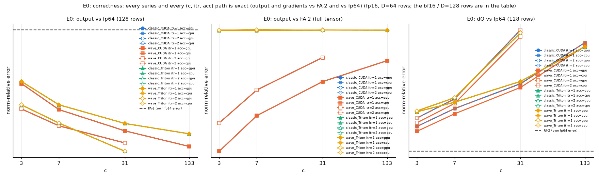

## E0b: correctness of the device-resident host-accumulator backward (the training path the default takes from 1M up): Q/K/V on the device, dQ/dK/dV accumulated in host memory, at every quorum size and both depths

| N | D | dtype | dir | c | itr | acc | qkv | W | arm | engine that ran | wall s | min s | peak GiB | workspace | host GiB | /FA-2 | /SDPA | ref | rel vs ref | grads | fp64 (x ref) | fp64 dq (x ref) | status |
|---|---|---|---|---|---|---|---|---|---|---|---|---|---|---|---|---|---|---|---|---|---|---|---|
| 256K | 64 | fp16 | bwd | 3 | 1 | cpu | device | - | classic_CUDA | classic/cuda itr=1 n_sub=3 | 3.252 | 3.252 | 3.45 | 2.44 | 4.43 | 2.492 | 2.318 | FA-2 | 1.1e-04 | 3.6e-04 | 2.7e-05 (0.96) | 3.2e-04 (1.05) | ok |
| 256K | 64 | fp16 | bwd | 3 | 2 | cpu | device | - | classic_CUDA | classic/cuda itr=2 n_sub=9 | 3.243 | 3.243 | 2.89 | 1.88 | 3.32 | 2.486 | 2.312 | FA-2 | 1.4e-04 | 3.6e-04 | 2.7e-05 (0.94) | 3.3e-04 (1.06) | ok |
| 256K | 64 | fp16 | bwd | 7 | 1 | cpu | device | - | classic_CUDA | classic/cuda itr=1 n_sub=7 | 2.921 | 2.921 | 2.85 | 1.84 | 3.36 | 2.239 | 2.082 | FA-2 | 1.5e-04 | 3.6e-04 | 2.7e-05 (0.94) | 3.3e-04 (1.08) | ok |
| 256K | 64 | fp16 | bwd | 7 | 2 | cpu | device | - | classic_CUDA | classic/cuda itr=2 n_sub=49 | 4.936 | 4.936 | 2.52 | 1.51 | 3.26 | 3.783 | 3.519 | FA-2 | 1.9e-04 | 3.6e-04 | 2.6e-05 (0.93) | 3.4e-04 (1.10) | ok |
| 256K | 64 | fp16 | bwd | 31 | 1 | cpu | device | - | classic_CUDA | classic/cuda itr=1 n_sub=31 | 3.644 | 3.644 | 2.52 | 1.51 | 3.06 | 2.793 | 2.598 | FA-2 | 2.0e-04 | 3.6e-04 | 2.6e-05 (0.92) | 3.5e-04 (1.13) | ok |
| 256K | 64 | fp16 | bwd | 31 | 2 | cpu | device | - | classic_CUDA | classic/cuda itr=2 n_sub=961 | 17.710 | 17.710 | 2.52 | 1.51 | 2.70 | 13.574 | 12.625 | FA-2 | 2.5e-04 | 3.6e-04 | 2.6e-05 (0.92) | 3.8e-04 (1.24) | ok |
| 256K | 64 | fp16 | bwd | 133 | 1 | cpu | device | - | classic_CUDA | classic/cuda itr=1 n_sub=133 | 6.150 | 6.150 | 2.52 | 1.51 | 2.69 | 4.713 | 4.384 | FA-2 | 2.4e-04 | 3.6e-04 | 2.6e-05 (0.91) | 3.7e-04 (1.21) | ok |
| 256K | 64 | fp16 | bwd | 3 | 1 | cpu | device | - | classic_Triton | classic/triton itr=1 n_sub=3 | 4.103 | 4.103 | 3.61 | 2.60 | 4.42 | 3.145 | 2.925 | FA-2 | 3.2e-04 | 5.6e-04 | 2.7e-05 (0.96) | 3.3e-04 (1.07) | ok |
| 256K | 64 | fp16 | bwd | 3 | 2 | cpu | device | - | classic_Triton | classic/triton itr=2 n_sub=9 | 4.072 | 4.072 | 3.00 | 1.99 | 3.34 | 3.121 | 2.903 | FA-2 | 3.2e-04 | 4.6e-04 | 2.7e-05 (0.94) | 3.3e-04 (1.08) | ok |
| 256K | 64 | fp16 | bwd | 7 | 1 | cpu | device | - | classic_Triton | classic/triton itr=1 n_sub=7 | 3.725 | 3.725 | 2.95 | 1.94 | 3.34 | 2.855 | 2.655 | FA-2 | 3.2e-04 | 4.5e-04 | 2.7e-05 (0.94) | 3.4e-04 (1.09) | ok |
| 256K | 64 | fp16 | bwd | 7 | 2 | cpu | device | - | classic_Triton | classic/triton itr=2 n_sub=49 | 5.882 | 5.882 | 2.52 | 1.51 | 3.05 | 4.508 | 4.193 | FA-2 | 3.2e-04 | 3.8e-04 | 2.6e-05 (0.93) | 3.4e-04 (1.10) | ok |
| 256K | 64 | fp16 | bwd | 31 | 1 | cpu | device | - | classic_Triton | classic/triton itr=1 n_sub=31 | 4.555 | 4.555 | 2.52 | 1.51 | 3.03 | 3.491 | 3.247 | FA-2 | 3.2e-04 | 3.8e-04 | 2.6e-05 (0.93) | 3.5e-04 (1.13) | ok |
| 256K | 64 | fp16 | bwd | 31 | 2 | cpu | device | - | classic_Triton | classic/triton itr=2 n_sub=961 | 23.462 | 23.462 | 2.52 | 1.51 | 2.70 | 17.983 | 16.726 | FA-2 | 3.2e-04 | 3.7e-04 | 2.6e-05 (0.91) | 3.8e-04 (1.24) | ok |
| 256K | 64 | fp16 | bwd | 133 | 1 | cpu | device | - | classic_Triton | classic/triton itr=1 n_sub=133 | 7.718 | 7.718 | 2.52 | 1.51 | 2.71 | 5.915 | 5.502 | FA-2 | 3.2e-04 | 3.7e-04 | 2.6e-05 (0.92) | 3.7e-04 (1.21) | ok |

Worst case per series over all E0 rows (ok rows only; the reference arm is FA-2):

| series | rows | max rel vs FA-2 (output) | max rel vs FA-2 (grads) | max fp64 err (output) | max fp64 err / FA-2's | max fp64 err (dQ) | max fp64 dQ err / FA-2's |
|---|---|---|---|---|---|---|---|
| classic_CUDA | 7 | 2.5e-04 | 3.6e-04 | 2.7e-05 | 0.96 | 3.8e-04 | 1.24 |
| classic_Triton | 7 | 3.2e-04 | 5.6e-04 | 2.7e-05 | 0.96 | 3.8e-04 | 1.24 |

Rows above 1.2x FA-2's own fp64 error: 4 -- E0b:all      classic_CUDA   N=  262144 D= 64 fp16 bwd c= 31 itr=  2 acc=cpu qkv=device; E0b:all      classic_CUDA   N=  262144 D= 64 fp16 bwd c=133 itr=  1 acc=cpu qkv=device; E0b:all      classic_Triton N=  262144 D= 64 fp16 bwd c= 31 itr=  2 acc=cpu qkv=device; E0b:all      classic_Triton N=  262144 D= 64 fp16 bwd c=133 itr=  1 acc=cpu qkv=device

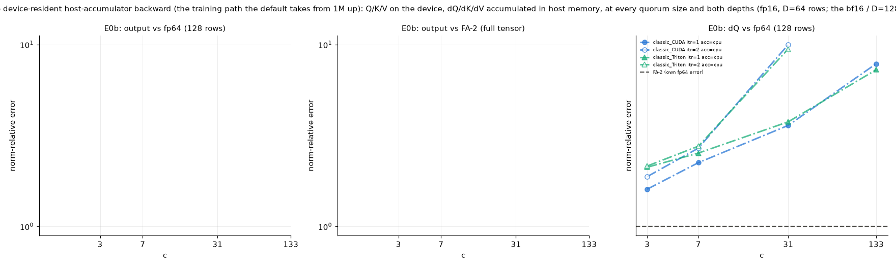

## E1: scaling: wall and peak memory vs N, device-resident, at the depth the memory allows

| N | D | dtype | dir | c | itr | acc | qkv | W | arm | engine that ran | wall s | min s | peak GiB | workspace | host GiB | /FA-2 | /SDPA | ref | rel vs ref | grads | fp64 (x ref) | fp64 dq (x ref) | status |
|---|---|---|---|---|---|---|---|---|---|---|---|---|---|---|---|---|---|---|---|---|---|---|---|
| 128K | 64 | fp16 | fwd | - | - | - | device | - | FA-2 | monolithic | 0.090 | 0.090 | 0.51 | 0.13 | 0.00 | 1.000 | 0.890 | - | - | - | 9.7e-05 | - | ok |
| 128K | 64 | fp16 | fwd | - | - | - | device | - | SDPA | monolithic | 0.101 | 0.101 | 0.51 | 0.13 | 0.00 | 1.124 | 1.000 | - | - | - | 9.7e-05 | - | ok |
| 128K | 64 | fp16 | fwd | 7 | min | gpu | device | - | classic_CUDA | classic/cuda itr=1 n_sub=7 | 0.114 | 0.114 | 1.19 | 0.81 | 0.01 | 1.268 | 1.128 | - | - | - | 9.7e-05 | - | ok |
| 128K | 64 | fp16 | fwd | 7 | min | gpu | device | - | wave_CUDA | wave/cuda itr=1 n_sub=7 waves=2 | 0.119 | 0.119 | 2.19 | 1.81 | 0.01 | 1.325 | 1.179 | - | - | - | 9.7e-05 | - | ok |
| 128K | 64 | fp16 | fwd | 7 | min | gpu | device | - | classic_Triton | classic/triton itr=1 n_sub=7 | 0.170 | 0.170 | 1.19 | 0.81 | 0.01 | 1.892 | 1.684 | - | - | - | 9.7e-05 | - | ok |
| 128K | 64 | fp16 | fwd | 7 | min | gpu | device | - | wave_Triton | wave/triton itr=1 n_sub=7 waves=2 | 0.182 | 0.182 | 3.58 | 3.20 | 0.01 | 2.026 | 1.802 | - | - | - | 9.7e-05 | - | ok |
| 128K | 64 | fp16 | bwd | - | - | - | device | - | FA-2 | monolithic | 0.327 | 0.327 | 1.27 | 0.76 | 0.00 | 1.000 | 0.933 | - | - | - | 9.7e-05 | 3.1e-04 | ok |
| 128K | 64 | fp16 | bwd | - | - | - | device | - | SDPA | monolithic | 0.351 | 0.351 | 1.52 | 1.01 | 0.00 | 1.072 | 1.000 | - | - | - | 9.7e-05 | 3.1e-04 | ok |
| 128K | 64 | fp16 | bwd | 7 | min | gpu | device | - | classic_CUDA | classic/cuda itr=1 n_sub=7 | 0.374 | 0.374 | 2.40 | 1.89 | 0.01 | 1.144 | 1.067 | - | - | - | 9.7e-05 | 3.1e-04 | ok |
| 128K | 64 | fp16 | bwd | 7 | min | gpu | device | - | wave_CUDA | wave/cuda itr=1 n_sub=7 waves=2 | 0.383 | 0.383 | 3.98 | 3.47 | 0.01 | 1.170 | 1.091 | - | - | - | 9.7e-05 | 2.8e-04 | ok |
| 128K | 64 | fp16 | bwd | 7 | min | gpu | device | - | classic_Triton | classic/triton itr=1 n_sub=7 | 0.653 | 0.653 | 2.40 | 1.89 | 0.01 | 1.996 | 1.862 | - | - | - | 9.7e-05 | 3.1e-04 | ok |
| 128K | 64 | fp16 | bwd | 7 | min | gpu | device | - | wave_Triton | classic/triton itr=1 n_sub=7 | 0.652 | 0.652 | 2.40 | 1.89 | 0.01 | 1.993 | 1.859 | - | - | - | 9.7e-05 | 3.1e-04 | ok |
| 256K | 64 | fp16 | fwd | - | - | - | device | - | FA-2 | monolithic | 0.363 | 0.363 | 1.02 | 0.26 | 0.00 | 1.000 | 0.947 | - | - | - | 2.8e-05 | - | ok |
| 256K | 64 | fp16 | fwd | - | - | - | device | - | SDPA | monolithic | 0.383 | 0.383 | 1.02 | 0.26 | 0.00 | 1.056 | 1.000 | - | - | - | 2.8e-05 | - | ok |
| 256K | 64 | fp16 | fwd | 7 | min | gpu | device | - | classic_CUDA | classic/cuda itr=1 n_sub=7 | 0.385 | 0.385 | 2.38 | 1.62 | 0.02 | 1.061 | 1.004 | - | - | - | 2.7e-05 | - | ok |
| 256K | 64 | fp16 | fwd | 7 | min | gpu | device | - | wave_CUDA | wave/cuda itr=1 n_sub=7 waves=7 | 0.411 | 0.411 | 2.61 | 1.86 | 0.02 | 1.134 | 1.074 | - | - | - | 2.7e-05 | - | ok |
| 256K | 64 | fp16 | fwd | 7 | min | gpu | device | - | classic_Triton | classic/triton itr=1 n_sub=7 | 0.602 | 0.602 | 2.38 | 1.62 | 0.02 | 1.658 | 1.570 | - | - | - | 2.7e-05 | - | ok |
| 256K | 64 | fp16 | fwd | 7 | min | gpu | device | - | wave_Triton | wave/triton itr=1 n_sub=7 waves=7 | 0.638 | 0.638 | 3.12 | 2.36 | 0.02 | 1.760 | 1.666 | - | - | - | 2.7e-05 | - | ok |
| 256K | 64 | fp16 | bwd | - | - | - | device | - | FA-2 | monolithic | 1.305 | 1.305 | 2.52 | 1.52 | 0.00 | 1.000 | 0.930 | - | - | - | 2.8e-05 | 3.1e-04 | ok |
| 256K | 64 | fp16 | bwd | - | - | - | device | - | SDPA | monolithic | 1.403 | 1.403 | 3.02 | 2.02 | 0.00 | 1.075 | 1.000 | - | - | - | 2.8e-05 | 3.1e-04 | ok |
| 256K | 64 | fp16 | bwd | 7 | min | gpu | device | - | classic_CUDA | classic/cuda itr=1 n_sub=7 | 1.379 | 1.379 | 4.78 | 3.77 | 0.02 | 1.057 | 0.983 | - | - | - | 2.7e-05 | 3.3e-04 | ok |
| 256K | 64 | fp16 | bwd | 7 | min | gpu | device | - | wave_CUDA | wave/cuda itr=1 n_sub=7 waves=7 | 1.421 | 1.421 | 5.00 | 3.99 | 0.02 | 1.089 | 1.013 | - | - | - | 2.7e-05 | 3.3e-04 | ok |
| 256K | 64 | fp16 | bwd | 7 | min | gpu | device | - | classic_Triton | classic/triton itr=1 n_sub=7 | 2.402 | 2.402 | 4.78 | 3.77 | 0.02 | 1.841 | 1.712 | - | - | - | 2.7e-05 | 3.4e-04 | ok |
| 256K | 64 | fp16 | bwd | 7 | min | gpu | device | - | wave_Triton | classic/triton itr=1 n_sub=7 | 2.402 | 2.402 | 4.78 | 3.77 | 0.02 | 1.841 | 1.712 | - | - | - | 2.7e-05 | 3.4e-04 | ok |
| 512K | 64 | fp16 | fwd | - | - | - | device | - | FA-2 | monolithic | 1.480 | 1.480 | 2.02 | 0.52 | 0.00 | 1.000 | 0.950 | - | - | - | 2.4e-05 | - | ok |
| 512K | 64 | fp16 | fwd | - | - | - | device | - | SDPA | monolithic | 1.557 | 1.557 | 2.02 | 0.52 | 0.00 | 1.052 | 1.000 | - | - | - | 2.4e-05 | - | ok |
| 512K | 64 | fp16 | fwd | 7 | min | gpu | device | - | classic_CUDA | classic/cuda itr=1 n_sub=7 | 1.479 | 1.479 | 4.75 | 3.25 | 0.04 | 1.000 | 0.950 | - | - | - | 2.0e-05 | - | ok |
| 512K | 64 | fp16 | fwd | 7 | min | gpu | device | - | wave_CUDA | wave/cuda itr=1 n_sub=7 waves=7 | 1.542 | 1.542 | 5.22 | 3.71 | 0.04 | 1.042 | 0.990 | - | - | - | 2.0e-05 | - | ok |
| 512K | 64 | fp16 | fwd | 7 | min | gpu | device | - | classic_Triton | classic/triton itr=1 n_sub=7 | 2.276 | 2.276 | 4.75 | 3.25 | 0.04 | 1.538 | 1.461 | - | - | - | 2.0e-05 | - | ok |
| 512K | 64 | fp16 | fwd | 7 | min | gpu | device | - | wave_Triton | wave/triton itr=1 n_sub=7 waves=7 | 2.364 | 2.364 | 6.23 | 4.72 | 0.04 | 1.598 | 1.518 | - | - | - | 2.0e-05 | - | ok |
| 512K | 64 | fp16 | bwd | - | - | - | device | - | FA-2 | monolithic | 5.242 | 5.242 | 5.04 | 3.03 | 0.00 | 1.000 | 0.933 | - | - | - | 2.4e-05 | 3.4e-04 | ok |
| 512K | 64 | fp16 | bwd | - | - | - | device | - | SDPA | monolithic | 5.621 | 5.621 | 6.04 | 4.03 | 0.00 | 1.072 | 1.000 | - | - | - | 2.4e-05 | 3.4e-04 | ok |
| 512K | 64 | fp16 | bwd | 7 | min | gpu | device | - | classic_CUDA | classic/cuda itr=1 n_sub=7 | 5.310 | 5.310 | 9.54 | 7.53 | 0.04 | 1.013 | 0.945 | - | - | - | 2.0e-05 | 3.6e-04 | ok |
| 512K | 64 | fp16 | bwd | 7 | min | gpu | device | - | wave_CUDA | wave/cuda itr=1 n_sub=7 waves=7 | 5.401 | 5.401 | 10.00 | 7.99 | 0.04 | 1.030 | 0.961 | - | - | - | 2.0e-05 | 3.6e-04 | ok |
| 512K | 64 | fp16 | bwd | 7 | min | gpu | device | - | classic_Triton | classic/triton itr=1 n_sub=7 | 9.306 | 9.306 | 9.54 | 7.53 | 0.04 | 1.775 | 1.656 | - | - | - | 2.0e-05 | 3.7e-04 | ok |
| 512K | 64 | fp16 | bwd | 7 | min | gpu | device | - | wave_Triton | classic/triton itr=1 n_sub=7 | 9.306 | 9.306 | 9.54 | 7.53 | 0.04 | 1.775 | 1.656 | - | - | - | 2.0e-05 | 3.7e-04 | ok |
| 1M | 64 | fp16 | fwd | - | - | - | device | - | FA-2 | monolithic | 6.031 | 6.031 | 4.04 | 1.03 | 0.00 | 1.000 | 0.955 | - | - | - | 2.5e-05 | - | ok |
| 1M | 64 | fp16 | fwd | - | - | - | device | - | SDPA | monolithic | 6.319 | 6.319 | 4.04 | 1.03 | 0.00 | 1.048 | 1.000 | - | - | - | 2.5e-05 | - | ok |
| 1M | 64 | fp16 | fwd | 7 | min | gpu | device | - | classic_CUDA | classic/cuda itr=1 n_sub=7 | 5.849 | 5.849 | 9.49 | 6.48 | 0.09 | 0.970 | 0.926 | - | - | - | 1.6e-05 | - | ok |
| 1M | 64 | fp16 | fwd | 7 | min | gpu | device | - | wave_CUDA | wave/cuda itr=1 n_sub=7 waves=7 | 6.035 | 6.035 | 10.43 | 7.42 | 0.07 | 1.001 | 0.955 | - | - | - | 1.6e-05 | - | ok |
| 1M | 64 | fp16 | fwd | 7 | min | gpu | device | - | classic_Triton | classic/triton itr=1 n_sub=7 | 8.930 | 8.930 | 9.49 | 6.48 | 0.09 | 1.481 | 1.413 | - | - | - | 1.6e-05 | - | ok |
| 1M | 64 | fp16 | fwd | 7 | min | gpu | device | - | wave_Triton | wave/triton itr=1 n_sub=7 waves=7 | 9.161 | 9.161 | 10.96 | 7.95 | 0.07 | 1.519 | 1.450 | - | - | - | 1.6e-05 | - | ok |
| 1M | 64 | fp16 | bwd | - | - | - | device | - | FA-2 | monolithic | 21.025 | 21.025 | 10.07 | 6.06 | 0.00 | 1.000 | 0.931 | - | - | - | 2.5e-05 | 4.8e-04 | ok |
| 1M | 64 | fp16 | bwd | - | - | - | device | - | SDPA | monolithic | 22.579 | 22.579 | 12.07 | 8.06 | 0.00 | 1.074 | 1.000 | - | - | - | 2.5e-05 | 4.8e-04 | ok |
| 1M | 64 | fp16 | bwd | 7 | min | gpu | device | - | classic_CUDA | classic/cuda itr=1 n_sub=7 | 20.880 | 20.880 | 19.06 | 15.06 | 0.09 | 0.993 | 0.925 | - | - | - | 1.6e-05 | 4.9e-04 | ok |
| 1M | 64 | fp16 | bwd | 7 | min | gpu | device | - | wave_CUDA | wave/cuda itr=1 n_sub=7 waves=7 | 21.127 | 21.127 | 19.99 | 15.98 | 0.08 | 1.005 | 0.936 | - | - | - | 1.6e-05 | 4.9e-04 | ok |
| 1M | 64 | fp16 | bwd | 7 | min | gpu | device | - | classic_Triton | classic/triton itr=1 n_sub=7 | 36.966 | 36.966 | 19.06 | 15.06 | 0.09 | 1.758 | 1.637 | - | - | - | 1.6e-05 | 5.3e-04 | ok |
| 1M | 64 | fp16 | bwd | 7 | min | gpu | device | - | wave_Triton | classic/triton itr=1 n_sub=7 | 36.999 | 36.999 | 19.06 | 15.06 | 0.09 | 1.760 | 1.639 | - | - | - | 1.6e-05 | 5.3e-04 | ok |
| 2M | 64 | fp16 | fwd | - | - | - | device | - | FA-2 | monolithic | 24.402 | 24.402 | 8.07 | 2.06 | 0.00 | 1.000 | 0.956 | - | - | - | 3.0e-05 | - | ok |
| 2M | 64 | fp16 | fwd | - | - | - | device | - | SDPA | monolithic | 25.531 | 25.531 | 8.07 | 2.06 | 0.00 | 1.046 | 1.000 | - | - | - | 3.0e-05 | - | ok |
| 2M | 64 | fp16 | fwd | 7 | min | gpu | device | - | classic_CUDA | classic/cuda itr=1 n_sub=7 | 23.298 | 23.298 | 18.97 | 12.97 | 0.17 | 0.955 | 0.913 | - | - | - | 1.5e-05 | - | ok |
| 2M | 64 | fp16 | fwd | 7 | min | gpu | device | - | wave_CUDA | wave/cuda itr=1 n_sub=7 waves=7 | 23.977 | 23.977 | 20.84 | 14.84 | 0.14 | 0.983 | 0.939 | - | - | - | 1.5e-05 | - | ok |
| 2M | 64 | fp16 | fwd | 7 | min | gpu | device | - | classic_Triton | classic/triton itr=1 n_sub=7 | 35.495 | 35.495 | 18.97 | 12.97 | 0.17 | 1.455 | 1.390 | - | - | - | 1.5e-05 | - | ok |
| 2M | 64 | fp16 | fwd | 7 | min | gpu | device | - | wave_Triton | wave/triton itr=1 n_sub=7 waves=7 | 36.289 | 36.289 | 19.83 | 13.82 | 0.14 | 1.487 | 1.421 | - | - | - | 1.5e-05 | - | ok |
| 2M | 64 | fp16 | bwd | - | - | - | device | - | FA-2 | monolithic | 84.121 | 84.121 | 20.13 | 12.13 | 0.00 | 1.000 | 0.933 | - | - | - | 3.0e-05 | 8.0e-04 | ok |
| 2M | 64 | fp16 | bwd | - | - | - | device | - | SDPA | monolithic | 90.150 | 90.150 | 24.13 | 16.13 | 0.00 | 1.072 | 1.000 | - | - | - | 3.0e-05 | 8.0e-04 | ok |
| 2M | 64 | fp16 | bwd | 7 | min | gpu | device | - | classic_CUDA | classic/cuda itr=1 n_sub=7 | 83.080 | 83.080 | 38.12 | 30.11 | 0.17 | 0.988 | 0.922 | - | - | - | 1.5e-05 | 8.0e-04 | ok |
| 2M | 64 | fp16 | bwd | 7 | min | gpu | device | - | wave_CUDA | wave/cuda itr=1 n_sub=7 waves=7 | 83.848 | 83.848 | 39.95 | 31.94 | 0.15 | 0.997 | 0.930 | - | - | - | 1.5e-05 | 8.0e-04 | ok |
| 2M | 64 | fp16 | bwd | 7 | min | gpu | device | - | classic_Triton | classic/triton itr=1 n_sub=7 | 147.690 | 147.690 | 38.12 | 30.11 | 0.17 | 1.756 | 1.638 | - | - | - | 1.5e-05 | 8.9e-04 | ok |
| 2M | 64 | fp16 | bwd | 7 | min | gpu | device | - | wave_Triton | classic/triton itr=1 n_sub=7 | 148.172 | 148.172 | 38.12 | 30.11 | 0.17 | 1.761 | 1.644 | - | - | - | 1.5e-05 | 8.9e-04 | ok |
| 4M | 64 | fp16 | fwd | - | - | - | device | - | FA-2 | monolithic | 97.674 | 97.674 | 16.13 | 4.13 | 0.00 | 1.000 | 0.959 | - | - | - | 4.2e-05 | - | ok |
| 4M | 64 | fp16 | fwd | - | - | - | device | - | SDPA | monolithic | 101.880 | 101.880 | 16.13 | 4.13 | 0.00 | 1.043 | 1.000 | - | - | - | 4.2e-05 | - | ok |
| 4M | 64 | fp16 | fwd | 7 | min | gpu | device | - | classic_CUDA | classic/cuda itr=1 n_sub=7 | 92.666 | 92.666 | 37.93 | 25.92 | 0.35 | 0.949 | 0.910 | - | - | - | 1.9e-05 | - | ok |
| 4M | 64 | fp16 | fwd | 7 | min | gpu | device | - | wave_CUDA | wave/cuda itr=1 n_sub=7 waves=7 | 96.155 | 96.155 | 41.68 | 29.67 | 0.28 | 0.984 | 0.944 | - | - | - | 1.9e-05 | - | ok |
| 4M | 64 | fp16 | fwd | 7 | min | gpu | device | - | classic_Triton | classic/triton itr=1 n_sub=7 | 142.202 | 142.202 | 37.93 | 25.92 | 0.34 | 1.456 | 1.396 | - | - | - | 2.0e-05 | - | ok |
| 4M | 64 | fp16 | fwd | 7 | min | gpu | device | - | wave_Triton | wave/triton itr=1 n_sub=7 waves=7 | 145.573 | 145.573 | 37.66 | 25.65 | 0.28 | 1.490 | 1.429 | - | - | - | 2.0e-05 | - | ok |
| 4M | 64 | fp16 | bwd | - | - | - | device | - | FA-2 | monolithic | 337.802 | 337.802 | 40.26 | 24.25 | 0.00 | 1.000 | 0.929 | - | - | - | 4.2e-05 | 1.4e-03 | ok |
| 4M | 64 | fp16 | bwd | - | - | - | device | - | SDPA | monolithic | 363.525 | 363.525 | 48.26 | 32.25 | 0.00 | 1.076 | 1.000 | - | - | - | 4.2e-05 | 1.4e-03 | ok |
| 4M | 64 | fp16 | bwd | 7 | min | gpu | device | - | classic_CUDA | classic/cuda itr=2 n_sub=49 | 340.949 | 340.949 | 64.13 | 48.12 | 0.86 | 1.009 | 0.938 | - | - | - | 1.1e-05 | 1.4e-03 | ok |
| 4M | 64 | fp16 | bwd | 7 | min | gpu | device | - | wave_CUDA | wave/cuda itr=4 n_sub=2401 waves=2401 | 379.991 | 379.991 | 76.26 | 60.25 | 5.24 | 1.125 | 1.045 | - | - | - | 7.8e-06 | 1.4e-03 | ok |
| 4M | 64 | fp16 | bwd | 7 | min | gpu | device | - | classic_Triton | classic/triton itr=2 n_sub=49 | 592.769 | 592.769 | 64.13 | 48.12 | 0.86 | 1.755 | 1.631 | - | - | - | 1.1e-05 | 1.4e-03 | ok |
| 4M | 64 | fp16 | bwd | 7 | min | gpu | device | - | wave_Triton | classic/triton itr=2 n_sub=49 | 592.690 | 592.690 | 64.13 | 48.12 | 0.87 | 1.755 | 1.630 | - | - | - | 1.1e-05 | 1.4e-03 | ok |

Fits (profile_sweep's: time quadratic in N, peak linear in N; >= 3 points; SXM rows):

- classic_CUDA/fwd: t[s] = 5.242*(N/1e6)^2 + 0.11*(N/1e6) + -0.006785 (R2 1.0000); peak[GiB] = 9.041*(N/1e6) + 0.01156 (R2 1.0000)
- classic_CUDA/bwd: t[s] = 19.83*(N/1e6)^2 + -2.04*(N/1e6) + 0.6502 (R2 1.0000); peak[GiB] = 15.35*(N/1e6) + 1.877 (R2 0.9910)
- wave_CUDA/fwd: t[s] = 5.48*(N/1e6)^2 + -0.07347*(N/1e6) + 0.05691 (R2 1.0000); peak[GiB] = 9.845*(N/1e6) + 0.2804 (R2 0.9995)
- wave_CUDA/bwd: t[s] = 23.9*(N/1e6)^2 + -10.44*(N/1e6) + 3 (R2 0.9998); peak[GiB] = 18.05*(N/1e6) + 1.026 (R2 0.9994)
- classic_Triton/fwd: t[s] = 8.096*(N/1e6)^2 + -0.0697*(N/1e6) + 0.06654 (R2 1.0000); peak[GiB] = 9.041*(N/1e6) + 0.01156 (R2 1.0000)
- classic_Triton/bwd: t[s] = 33.81*(N/1e6)^2 + -0.5357*(N/1e6) + 0.23 (R2 1.0000); peak[GiB] = 15.35*(N/1e6) + 1.877 (R2 0.9910)
- wave_Triton/fwd: t[s] = 8.297*(N/1e6)^2 + -0.1191*(N/1e6) + 0.1045 (R2 1.0000); peak[GiB] = 8.571*(N/1e6) + 1.769 (R2 0.9985)
- wave_Triton/bwd: t[s] = 33.71*(N/1e6)^2 + -0.09458*(N/1e6) + 0.087 (R2 1.0000); peak[GiB] = 15.35*(N/1e6) + 1.877 (R2 0.9910)
- FA-2/fwd: t[s] = 5.56*(N/1e6)^2 + -0.0289*(N/1e6) + -0.0192 (R2 1.0000); peak[GiB] = 3.844*(N/1e6) + 0.008439 (R2 1.0000)
- FA-2/bwd: t[s] = 19.27*(N/1e6)^2 + -0.3043*(N/1e6) + 0.07612 (R2 1.0000); peak[GiB] = 9.596*(N/1e6) + 0.008935 (R2 1.0000)
- SDPA/fwd: t[s] = 5.784*(N/1e6)^2 + 0.04056*(N/1e6) + -0.03273 (R2 1.0000); peak[GiB] = 3.844*(N/1e6) + 0.00844 (R2 1.0000)
- SDPA/bwd: t[s] = 20.81*(N/1e6)^2 + -0.6631*(N/1e6) + 0.1824 (R2 1.0000); peak[GiB] = 11.5*(N/1e6) + 0.008935 (R2 1.0000)

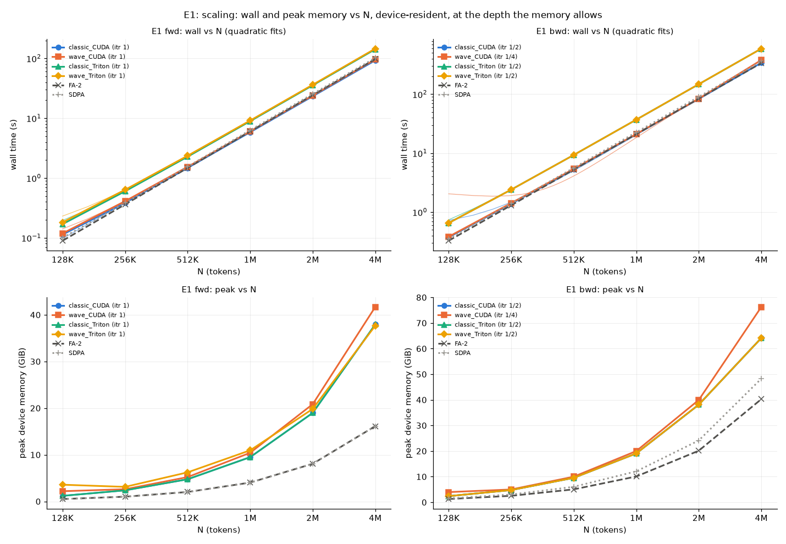

## E2: scaling, host-resident: Q/K/V and the accumulator in host memory (the recovery configuration)

| N | D | dtype | dir | c | itr | acc | qkv | W | arm | engine that ran | wall s | min s | peak GiB | workspace | host GiB | /FA-2 | /SDPA | ref | rel vs ref | grads | fp64 (x ref) | fp64 dq (x ref) | status |
|---|---|---|---|---|---|---|---|---|---|---|---|---|---|---|---|---|---|---|---|---|---|---|---|
| 4M | 64 | fp16 | fwd | - | - | - | device | - | FA-2 | monolithic | 136.075 | 136.075 | 16.13 | 4.13 | 0.00 | 1.000 | 1.039 | - | - | - | 4.2e-05 | - | ok |
| 4M | 64 | fp16 | fwd | - | - | - | device | - | SDPA | monolithic | 131.022 | 131.022 | 16.13 | 4.13 | 0.00 | 0.963 | 1.000 | - | - | - | 4.2e-05 | - | ok |
| 4M | 64 | fp16 | fwd | 7 | min | cpu | host | - | classic_CUDA | classic/cuda itr=1 n_sub=7 | 125.952 | 125.952 | 10.38 | 10.37 | 31.99 | 0.926 | 0.961 | - | - | - | 1.9e-05 | - | ok |
| 4M | 64 | fp16 | fwd | 7 | min | cpu | host | - | wave_CUDA | wave/cuda itr=1 n_sub=7 waves=7 | 129.934 | 129.934 | 19.10 | 19.10 | 33.98 | 0.955 | 0.992 | - | - | - | 1.9e-05 | - | ok |
| 4M | 64 | fp16 | fwd | 7 | min | cpu | host | - | classic_Triton | classic/triton itr=1 n_sub=7 | 182.459 | 182.459 | 8.66 | 8.66 | 31.97 | 1.341 | 1.393 | - | - | - | 2.0e-05 | - | ok |
| 4M | 64 | fp16 | fwd | 7 | min | cpu | host | - | wave_Triton | wave/triton itr=1 n_sub=7 waves=7 | 180.605 | 180.605 | 24.75 | 24.74 | 33.86 | 1.327 | 1.378 | - | - | - | 2.0e-05 | - | ok |
| 8M | 64 | fp16 | fwd | - | - | - | device | - | FA-2 | monolithic | 544.972 | 544.972 | 32.26 | 8.25 | 0.00 | 1.000 | 1.073 | - | - | - | 5.9e-05 | - | ok |
| 8M | 64 | fp16 | fwd | - | - | - | device | - | SDPA | monolithic | 507.855 | 507.855 | 32.26 | 8.25 | 0.00 | 0.932 | 1.000 | - | - | - | 5.9e-05 | - | ok |
| 8M | 64 | fp16 | fwd | 7 | min | cpu | host | - | classic_CUDA | classic/cuda itr=1 n_sub=7 | 526.604 | 526.604 | 20.75 | 20.75 | 64.79 | 0.966 | 1.037 | - | - | - | 2.5e-05 | - | ok |
| 8M | 64 | fp16 | fwd | 7 | min | cpu | host | - | wave_CUDA | wave/cuda itr=1 n_sub=7 waves=7 | 535.635 | 535.635 | 34.77 | 34.76 | 68.74 | 0.983 | 1.055 | - | - | - | 2.5e-05 | - | ok |
| 8M | 64 | fp16 | fwd | 7 | min | cpu | host | - | classic_Triton | classic/triton itr=1 n_sub=7 | 708.496 | 708.496 | 17.32 | 17.31 | 64.83 | 1.300 | 1.395 | - | - | - | 2.5e-05 | - | ok |
| 8M | 64 | fp16 | fwd | 7 | min | cpu | host | - | wave_Triton | wave/triton itr=1 n_sub=7 waves=7 | 716.092 | 716.092 | 47.22 | 47.21 | 68.62 | 1.314 | 1.410 | - | - | - | 2.5e-05 | - | ok |
| 128K | 64 | fp16 | fwd | 7 | min | cpu | host | - | classic_CUDA | classic/cuda itr=1 n_sub=7 | 0.498 | 0.498 | 0.50 | 0.49 | 1.40 | 5.546 | 4.935 | - | - | - | 9.7e-05 | - | ok |
| 128K | 64 | fp16 | fwd | 7 | min | cpu | host | - | wave_CUDA | wave/cuda itr=1 n_sub=7 waves=4 | 0.341 | 0.341 | 0.79 | 0.78 | 1.44 | 3.802 | 3.383 | - | - | - | 9.7e-05 | - | ok |
| 128K | 64 | fp16 | fwd | 7 | min | cpu | host | - | classic_Triton | classic/triton itr=1 n_sub=7 | 0.501 | 0.501 | 0.28 | 0.27 | 1.40 | 5.585 | 4.970 | - | - | - | 9.7e-05 | - | ok |
| 128K | 64 | fp16 | fwd | 7 | min | cpu | host | - | wave_Triton | wave/triton itr=1 n_sub=7 waves=4 | 0.365 | 0.365 | 1.94 | 1.93 | 1.43 | 4.069 | 3.621 | - | - | - | 9.7e-05 | - | ok |
| 128K | 64 | fp16 | bwd | 7 | min | cpu | host | - | classic_CUDA | classic/cuda itr=1 n_sub=7 | 1.231 | 1.231 | 0.72 | 0.71 | 2.24 | 3.765 | 3.511 | - | - | - | 9.7e-05 | 3.1e-04 | ok |
| 128K | 64 | fp16 | bwd | 7 | min | cpu | host | - | wave_CUDA | classic/cuda itr=1 n_sub=7 | 1.240 | 1.240 | 0.72 | 0.71 | 2.43 | 3.791 | 3.535 | - | - | - | 9.7e-05 | 3.1e-04 | ok |
| 128K | 64 | fp16 | bwd | 7 | min | cpu | host | - | classic_Triton | classic/triton itr=1 n_sub=7 | 1.491 | 1.491 | 0.76 | 0.75 | 2.23 | 4.561 | 4.253 | - | - | - | 9.7e-05 | 3.1e-04 | ok |
| 128K | 64 | fp16 | bwd | 7 | min | cpu | host | - | wave_Triton | classic/triton itr=1 n_sub=7 | 1.518 | 1.518 | 0.76 | 0.75 | 2.23 | 4.642 | 4.329 | - | - | - | 9.7e-05 | 3.1e-04 | ok |
| 256K | 64 | fp16 | fwd | 7 | min | cpu | host | - | classic_CUDA | classic/cuda itr=1 n_sub=7 | 0.930 | 0.930 | 0.66 | 0.65 | 1.97 | 2.564 | 2.428 | - | - | - | 2.7e-05 | - | ok |
| 256K | 64 | fp16 | fwd | 7 | min | cpu | host | - | wave_CUDA | wave/cuda itr=1 n_sub=7 waves=7 | 0.738 | 0.738 | 1.20 | 1.20 | 2.22 | 2.033 | 1.925 | - | - | - | 2.7e-05 | - | ok |
| 256K | 64 | fp16 | fwd | 7 | min | cpu | host | - | classic_Triton | classic/triton itr=1 n_sub=7 | 1.282 | 1.282 | 0.55 | 0.54 | 2.01 | 3.534 | 3.346 | - | - | - | 2.7e-05 | - | ok |
| 256K | 64 | fp16 | fwd | 7 | min | cpu | host | - | wave_Triton | wave/triton itr=1 n_sub=7 waves=7 | 1.041 | 1.041 | 2.32 | 2.31 | 2.14 | 2.870 | 2.717 | - | - | - | 2.7e-05 | - | ok |
| 256K | 64 | fp16 | bwd | 7 | min | cpu | host | - | classic_CUDA | classic/cuda itr=1 n_sub=7 | 2.946 | 2.946 | 1.41 | 1.40 | 4.37 | 2.258 | 2.100 | - | - | - | 2.7e-05 | 3.3e-04 | ok |
| 256K | 64 | fp16 | bwd | 7 | min | cpu | host | - | wave_CUDA | classic/cuda itr=1 n_sub=7 | 2.984 | 2.984 | 1.41 | 1.40 | 4.57 | 2.287 | 2.127 | - | - | - | 2.7e-05 | 3.3e-04 | ok |
| 256K | 64 | fp16 | bwd | 7 | min | cpu | host | - | classic_Triton | classic/triton itr=1 n_sub=7 | 4.086 | 4.086 | 1.52 | 1.51 | 4.38 | 3.131 | 2.913 | - | - | - | 2.7e-05 | 3.4e-04 | ok |
| 256K | 64 | fp16 | bwd | 7 | min | cpu | host | - | wave_Triton | classic/triton itr=1 n_sub=7 | 4.044 | 4.044 | 1.52 | 1.51 | 4.39 | 3.099 | 2.883 | - | - | - | 2.7e-05 | 3.4e-04 | ok |
| 512K | 64 | fp16 | fwd | 7 | min | cpu | host | - | classic_CUDA | classic/cuda itr=1 n_sub=7 | 2.069 | 2.069 | 1.31 | 1.30 | 3.90 | 1.398 | 1.328 | - | - | - | 2.0e-05 | - | ok |
| 512K | 64 | fp16 | fwd | 7 | min | cpu | host | - | wave_CUDA | wave/cuda itr=1 n_sub=7 waves=7 | 2.177 | 2.177 | 2.40 | 2.39 | 4.32 | 1.471 | 1.398 | - | - | - | 2.0e-05 | - | ok |
| 512K | 64 | fp16 | fwd | 7 | min | cpu | host | - | classic_Triton | classic/triton itr=1 n_sub=7 | 3.568 | 3.568 | 1.09 | 1.08 | 3.80 | 2.411 | 2.291 | - | - | - | 2.0e-05 | - | ok |
| 512K | 64 | fp16 | fwd | 7 | min | cpu | host | - | wave_Triton | wave/triton itr=1 n_sub=7 waves=7 | 3.092 | 3.092 | 4.63 | 4.62 | 4.15 | 2.089 | 1.985 | - | - | - | 2.0e-05 | - | ok |
| 512K | 64 | fp16 | bwd | 7 | min | cpu | host | - | classic_CUDA | classic/cuda itr=1 n_sub=7 | 7.379 | 7.379 | 2.82 | 2.81 | 11.46 | 1.408 | 1.313 | - | - | - | 2.0e-05 | 3.6e-04 | ok |
| 512K | 64 | fp16 | bwd | 7 | min | cpu | host | - | wave_CUDA | classic/cuda itr=1 n_sub=7 | 7.495 | 7.495 | 2.82 | 2.81 | 11.63 | 1.430 | 1.333 | - | - | - | 2.0e-05 | 3.6e-04 | ok |
| 512K | 64 | fp16 | bwd | 7 | min | cpu | host | - | classic_Triton | classic/triton itr=1 n_sub=7 | 10.617 | 10.617 | 3.02 | 3.01 | 11.20 | 2.025 | 1.889 | - | - | - | 2.0e-05 | 3.7e-04 | ok |
| 512K | 64 | fp16 | bwd | 7 | min | cpu | host | - | wave_Triton | classic/triton itr=1 n_sub=7 | 10.690 | 10.690 | 3.02 | 3.01 | 11.19 | 2.039 | 1.902 | - | - | - | 2.0e-05 | 3.7e-04 | ok |
| 1M | 64 | fp16 | fwd | 7 | min | cpu | host | - | classic_CUDA | classic/cuda itr=1 n_sub=7 | 7.083 | 7.083 | 2.60 | 2.60 | 7.47 | 1.174 | 1.121 | - | - | - | 1.6e-05 | - | ok |
| 1M | 64 | fp16 | fwd | 7 | min | cpu | host | - | wave_CUDA | wave/cuda itr=1 n_sub=7 waves=7 | 7.298 | 7.298 | 4.78 | 4.78 | 8.13 | 1.210 | 1.155 | - | - | - | 1.6e-05 | - | ok |
| 1M | 64 | fp16 | fwd | 7 | min | cpu | host | - | classic_Triton | classic/triton itr=1 n_sub=7 | 11.474 | 11.474 | 2.18 | 2.17 | 7.44 | 1.902 | 1.816 | - | - | - | 1.6e-05 | - | ok |
| 1M | 64 | fp16 | fwd | 7 | min | cpu | host | - | wave_Triton | wave/triton itr=1 n_sub=7 waves=7 | 10.558 | 10.558 | 7.75 | 7.75 | 8.04 | 1.751 | 1.671 | - | - | - | 1.6e-05 | - | ok |
| 1M | 64 | fp16 | bwd | 7 | min | cpu | host | - | classic_CUDA | classic/cuda itr=1 n_sub=7 | 27.096 | 27.096 | 5.62 | 5.61 | 17.22 | 1.289 | 1.200 | - | - | - | 1.6e-05 | 4.9e-04 | ok |
| 1M | 64 | fp16 | bwd | 7 | min | cpu | host | - | wave_CUDA | classic/cuda itr=1 n_sub=7 | 26.984 | 26.984 | 5.62 | 5.61 | 17.46 | 1.283 | 1.195 | - | - | - | 1.6e-05 | 4.9e-04 | ok |
| 1M | 64 | fp16 | bwd | 7 | min | cpu | host | - | classic_Triton | classic/triton itr=1 n_sub=7 | 43.213 | 43.213 | 6.03 | 6.02 | 17.19 | 2.055 | 1.914 | - | - | - | 1.6e-05 | 5.3e-04 | ok |
| 1M | 64 | fp16 | bwd | 7 | min | cpu | host | - | wave_Triton | classic/triton itr=1 n_sub=7 | 43.301 | 43.301 | 6.03 | 6.02 | 17.19 | 2.059 | 1.918 | - | - | - | 1.6e-05 | 5.3e-04 | ok |
| 2M | 64 | fp16 | fwd | 7 | min | cpu | host | - | classic_CUDA | classic/cuda itr=1 n_sub=7 | 25.861 | 25.861 | 7.77 | 7.76 | 20.83 | 1.060 | 1.013 | - | - | - | 1.5e-05 | - | ok |
| 2M | 64 | fp16 | fwd | 7 | min | cpu | host | - | wave_CUDA | wave/cuda itr=1 n_sub=7 waves=7 | 26.689 | 26.689 | 9.56 | 9.55 | 16.94 | 1.094 | 1.045 | - | - | - | 1.5e-05 | - | ok |
| 2M | 64 | fp16 | fwd | 7 | min | cpu | host | - | classic_Triton | classic/triton itr=1 n_sub=7 | 38.297 | 38.297 | 4.34 | 4.33 | 20.78 | 1.569 | 1.500 | - | - | - | 1.5e-05 | - | ok |
| 2M | 64 | fp16 | fwd | 7 | min | cpu | host | - | wave_Triton | wave/triton itr=1 n_sub=7 waves=7 | 38.901 | 38.901 | 13.42 | 13.41 | 17.08 | 1.594 | 1.524 | - | - | - | 1.5e-05 | - | ok |
| 2M | 64 | fp16 | bwd | 7 | min | cpu | host | - | classic_CUDA | classic/cuda itr=1 n_sub=7 | 95.782 | 95.782 | 11.22 | 11.21 | 33.59 | 1.139 | 1.062 | - | - | - | 1.5e-05 | 8.0e-04 | ok |
| 2M | 64 | fp16 | bwd | 7 | min | cpu | host | - | wave_CUDA | classic/cuda itr=1 n_sub=7 | 95.540 | 95.540 | 11.22 | 11.21 | 34.16 | 1.136 | 1.060 | - | - | - | 1.5e-05 | 8.0e-04 | ok |
| 2M | 64 | fp16 | bwd | 7 | min | cpu | host | - | classic_Triton | classic/triton itr=1 n_sub=7 | 160.409 | 160.409 | 12.05 | 12.04 | 33.45 | 1.907 | 1.779 | - | - | - | 1.5e-05 | 8.9e-04 | ok |
| 2M | 64 | fp16 | bwd | 7 | min | cpu | host | - | wave_Triton | classic/triton itr=1 n_sub=7 | 160.617 | 160.617 | 12.05 | 12.04 | 33.45 | 1.909 | 1.782 | - | - | - | 1.5e-05 | 8.9e-04 | ok |
| 4M | 64 | fp16 | fwd | 7 | min | cpu | host | - | classic_CUDA | classic/cuda itr=1 n_sub=7 | 101.471 | 101.471 | 10.38 | 10.37 | 31.98 | 1.039 | 0.996 | - | - | - | 1.9e-05 | - | ok |
| 4M | 64 | fp16 | fwd | 7 | min | cpu | host | - | wave_CUDA | wave/cuda itr=1 n_sub=7 waves=7 | 102.665 | 102.665 | 19.10 | 19.10 | 33.98 | 1.051 | 1.008 | - | - | - | 1.9e-05 | - | ok |
| 4M | 64 | fp16 | fwd | 7 | min | cpu | host | - | classic_Triton | classic/triton itr=1 n_sub=7 | 151.357 | 151.357 | 8.66 | 8.66 | 31.96 | 1.550 | 1.486 | - | - | - | 2.0e-05 | - | ok |
| 4M | 64 | fp16 | fwd | 7 | min | cpu | host | - | wave_Triton | wave/triton itr=1 n_sub=7 waves=7 | 150.102 | 150.102 | 24.75 | 24.74 | 33.86 | 1.537 | 1.473 | - | - | - | 2.0e-05 | - | ok |
| 4M | 64 | fp16 | bwd | 7 | min | cpu | host | - | classic_CUDA | classic/cuda itr=1 n_sub=7 | 360.006 | 360.006 | 22.43 | 22.42 | 67.69 | 1.066 | 0.990 | - | - | - | 1.9e-05 | 1.4e-03 | ok |
| 4M | 64 | fp16 | bwd | 7 | min | cpu | host | - | wave_CUDA | classic/cuda itr=1 n_sub=7 | 358.573 | 358.573 | 22.43 | 22.42 | 68.01 | 1.061 | 0.986 | - | - | - | 1.9e-05 | 1.4e-03 | ok |
| 4M | 64 | fp16 | bwd | 7 | min | cpu | host | - | classic_Triton | classic/triton itr=1 n_sub=7 | 617.405 | 617.405 | 24.08 | 24.08 | 67.58 | 1.828 | 1.698 | - | - | - | 2.0e-05 | 1.6e-03 | ok |
| 4M | 64 | fp16 | bwd | 7 | min | cpu | host | - | wave_Triton | classic/triton itr=1 n_sub=7 | 617.644 | 617.644 | 24.08 | 24.08 | 67.68 | 1.828 | 1.699 | - | - | - | 2.0e-05 | 1.6e-03 | ok |

Fits (profile_sweep's: time quadratic in N, peak linear in N; >= 3 points; SXM rows):

- classic_CUDA/fwd: t[s] = 5.683*(N/1e6)^2 + 0.25*(N/1e6) + 0.4288 (R2 1.0000); peak[GiB] = 2.61*(N/1e6) + 0.2779 (R2 0.9409)
- classic_CUDA/bwd: t[s] = 19.15*(N/1e6)^2 + 5.509*(N/1e6) + -0.0346 (R2 1.0000); peak[GiB] = 5.343*(N/1e6) + 0.01428 (R2 1.0000)
- wave_CUDA/fwd: t[s] = 5.611*(N/1e6)^2 + 0.9094*(N/1e6) + 0.1364 (R2 1.0000); peak[GiB] = 4.533*(N/1e6) + 0.06796 (R2 0.9999)
- wave_CUDA/bwd: t[s] = 19.06*(N/1e6)^2 + 5.566*(N/1e6) + -0.006839 (R2 1.0000); peak[GiB] = 5.343*(N/1e6) + 0.01428 (R2 1.0000)
- classic_Triton/fwd: t[s] = 8.408*(N/1e6)^2 + 0.6289*(N/1e6) + 0.6842 (R2 0.9999); peak[GiB] = 2.063*(N/1e6) + 0.01115 (R2 1.0000)
- classic_Triton/bwd: t[s] = 33.74*(N/1e6)^2 + 5.764*(N/1e6) + -0.2619 (R2 1.0000); peak[GiB] = 5.739*(N/1e6) + 0.01171 (R2 1.0000)
- wave_Triton/fwd: t[s] = 8.22*(N/1e6)^2 + 1.279*(N/1e6) + 0.1234 (R2 1.0000); peak[GiB] = 5.621*(N/1e6) + 1.399 (R2 0.9981)
- wave_Triton/bwd: t[s] = 33.72*(N/1e6)^2 + 5.915*(N/1e6) + -0.29 (R2 1.0000); peak[GiB] = 5.739*(N/1e6) + 0.01171 (R2 1.0000)

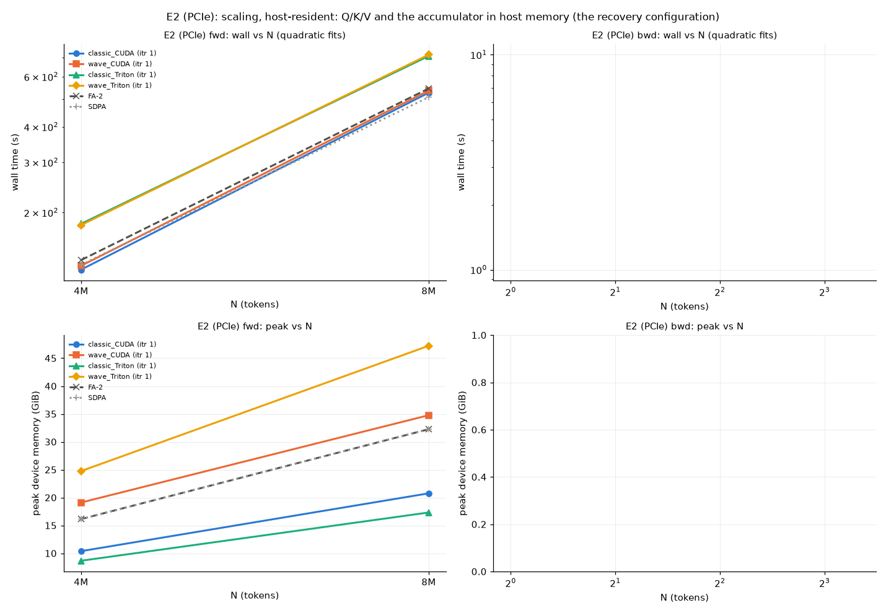

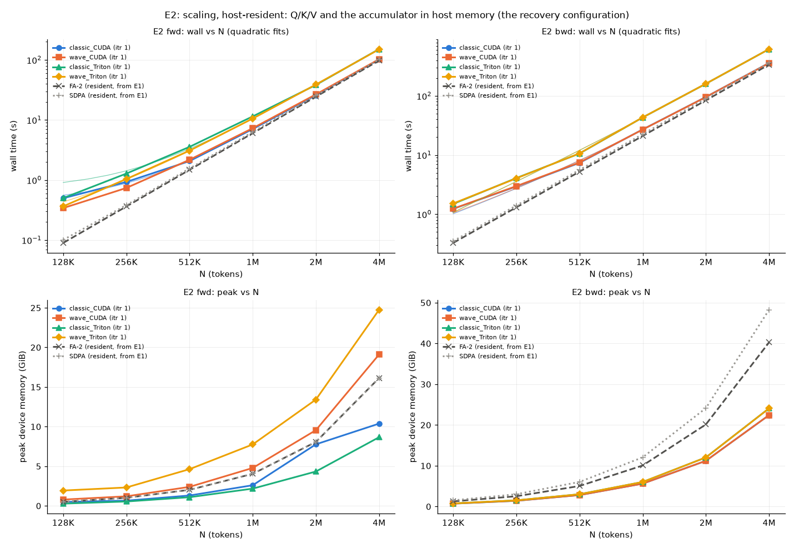

## E3: parameters: how the quorum size c shapes time and memory

| N | D | dtype | dir | c | itr | acc | qkv | W | arm | engine that ran | wall s | min s | peak GiB | workspace | host GiB | /FA-2 | /SDPA | ref | rel vs ref | grads | fp64 (x ref) | fp64 dq (x ref) | status |
|---|---|---|---|---|---|---|---|---|---|---|---|---|---|---|---|---|---|---|---|---|---|---|---|
| 1M | 64 | fp16 | fwd | 3 | 1 | gpu | device | - | classic_CUDA | classic/cuda itr=1 n_sub=3 | 5.841 | 5.835 | 11.95 | 8.94 | 0.08 | 0.968 | 0.924 | FA-2 | 2.0e-04 | - | 1.9e-05 (0.75) | - | ok |
| 1M | 64 | fp16 | fwd | 7 | 1 | gpu | device | - | classic_CUDA | classic/cuda itr=1 n_sub=7 | 5.864 | 5.861 | 9.49 | 6.48 | 0.08 | 0.972 | 0.928 | FA-2 | 2.7e-04 | - | 1.6e-05 (0.64) | - | ok |
| 1M | 64 | fp16 | fwd | 13 | 1 | gpu | device | - | classic_CUDA | classic/cuda itr=1 n_sub=13 | 5.899 | 5.894 | 8.24 | 5.24 | 0.12 | 0.978 | 0.934 | FA-2 | 2.9e-04 | - | 1.5e-05 (0.60) | - | ok |
| 1M | 64 | fp16 | fwd | 21 | 1 | gpu | device | - | classic_CUDA | classic/cuda itr=1 n_sub=21 | 5.935 | 5.935 | 7.53 | 4.52 | 0.10 | 0.984 | 0.939 | FA-2 | 3.1e-04 | - | 1.4e-05 (0.57) | - | ok |
| 1M | 64 | fp16 | fwd | 31 | 1 | gpu | device | - | classic_CUDA | classic/cuda itr=1 n_sub=31 | 5.966 | 5.962 | 7.17 | 4.16 | 0.14 | 0.989 | 0.944 | FA-2 | 3.3e-04 | - | 1.4e-05 (0.56) | - | ok |
| 1M | 64 | fp16 | fwd | 57 | 1 | gpu | device | - | classic_CUDA | classic/cuda itr=1 n_sub=57 | 6.043 | 6.039 | 7.17 | 4.16 | 0.24 | 1.002 | 0.956 | FA-2 | 3.5e-04 | - | 1.3e-05 (0.55) | - | ok |
| 1M | 64 | fp16 | fwd | 73 | 1 | gpu | device | - | classic_CUDA | classic/cuda itr=1 n_sub=73 | 6.082 | 6.077 | 7.17 | 4.16 | 0.16 | 1.008 | 0.962 | FA-2 | 3.6e-04 | - | 1.3e-05 (0.54) | - | ok |
| 1M | 64 | fp16 | fwd | 91 | 1 | gpu | device | - | classic_CUDA | classic/cuda itr=1 n_sub=91 | 6.125 | 6.124 | 7.17 | 4.16 | 0.19 | 1.016 | 0.969 | FA-2 | 3.6e-04 | - | 1.3e-05 (0.54) | - | ok |
| 1M | 64 | fp16 | fwd | 133 | 1 | gpu | device | - | classic_CUDA | classic/cuda itr=1 n_sub=133 | 6.204 | 6.202 | 7.17 | 4.16 | 0.28 | 1.029 | 0.982 | FA-2 | 3.7e-04 | - | 1.3e-05 (0.54) | - | ok |
| 1M | 64 | fp16 | fwd | 3 | 1 | gpu | device | - | wave_CUDA | wave/cuda itr=1 n_sub=3 waves=3 | 6.038 | 6.030 | 11.80 | 8.80 | 0.06 | 1.001 | 0.956 | FA-2 | 2.0e-04 | - | 1.9e-05 (0.75) | - | ok |
| 1M | 64 | fp16 | fwd | 7 | 1 | gpu | device | - | wave_CUDA | wave/cuda itr=1 n_sub=7 waves=7 | 6.062 | 6.056 | 10.43 | 7.42 | 0.06 | 1.005 | 0.959 | FA-2 | 2.7e-04 | - | 1.6e-05 (0.64) | - | ok |
| 1M | 64 | fp16 | fwd | 13 | 1 | gpu | device | - | wave_CUDA | wave/cuda itr=1 n_sub=13 waves=13 | 6.105 | 6.098 | 10.06 | 7.06 | 0.08 | 1.012 | 0.966 | FA-2 | 2.9e-04 | - | 1.5e-05 (0.60) | - | ok |
| 1M | 64 | fp16 | fwd | 21 | 1 | gpu | device | - | wave_CUDA | wave/cuda itr=1 n_sub=21 waves=21 | 6.159 | 6.155 | 9.85 | 6.84 | 0.09 | 1.021 | 0.975 | FA-2 | 3.1e-04 | - | 1.4e-05 (0.57) | - | ok |
| 1M | 64 | fp16 | fwd | 31 | 1 | gpu | device | - | wave_CUDA | wave/cuda itr=1 n_sub=31 waves=31 | 6.207 | 6.201 | 9.72 | 6.71 | 0.10 | 1.029 | 0.982 | FA-2 | 3.3e-04 | - | 1.4e-05 (0.56) | - | ok |
| 1M | 64 | fp16 | fwd | 57 | 1 | gpu | device | - | wave_CUDA | wave/cuda itr=1 n_sub=57 waves=57 | 6.307 | 6.306 | 9.56 | 6.55 | 0.13 | 1.046 | 0.998 | FA-2 | 3.5e-04 | - | 1.3e-05 (0.55) | - | ok |
| 1M | 64 | fp16 | fwd | 73 | 1 | gpu | device | - | wave_CUDA | wave/cuda itr=1 n_sub=73 waves=73 | 6.363 | 6.362 | 9.51 | 6.50 | 0.15 | 1.055 | 1.007 | FA-2 | 3.6e-04 | - | 1.3e-05 (0.54) | - | ok |
| 1M | 64 | fp16 | fwd | 91 | 1 | gpu | device | - | wave_CUDA | wave/cuda itr=1 n_sub=91 waves=91 | 6.425 | 6.424 | 9.46 | 6.46 | 0.17 | 1.065 | 1.017 | FA-2 | 3.6e-04 | - | 1.3e-05 (0.54) | - | ok |
| 1M | 64 | fp16 | fwd | 133 | 1 | gpu | device | - | wave_CUDA | wave/cuda itr=1 n_sub=133 waves=133 | 6.555 | 6.553 | 9.41 | 6.40 | 0.20 | 1.087 | 1.037 | FA-2 | 3.7e-04 | - | 1.3e-05 (0.54) | - | ok |
| 1M | 64 | fp16 | fwd | 3 | 1 | gpu | device | - | classic_Triton | classic/triton itr=1 n_sub=3 | 8.906 | 8.906 | 11.95 | 8.94 | 0.08 | 1.477 | 1.410 | FA-2 | 4.3e-04 | - | 1.9e-05 (0.76) | - | ok |
| 1M | 64 | fp16 | fwd | 7 | 1 | gpu | device | - | classic_Triton | classic/triton itr=1 n_sub=7 | 8.923 | 8.923 | 9.49 | 6.48 | 0.08 | 1.480 | 1.412 | FA-2 | 4.3e-04 | - | 1.6e-05 (0.65) | - | ok |
| 1M | 64 | fp16 | fwd | 13 | 1 | gpu | device | - | classic_Triton | classic/triton itr=1 n_sub=13 | 8.943 | 8.942 | 8.24 | 5.24 | 0.12 | 1.483 | 1.415 | FA-2 | 4.3e-04 | - | 1.5e-05 (0.60) | - | ok |
| 1M | 64 | fp16 | fwd | 21 | 1 | gpu | device | - | classic_Triton | classic/triton itr=1 n_sub=21 | 9.037 | 9.036 | 7.53 | 4.52 | 0.10 | 1.498 | 1.430 | FA-2 | 4.3e-04 | - | 1.4e-05 (0.58) | - | ok |
| 1M | 64 | fp16 | fwd | 31 | 1 | gpu | device | - | classic_Triton | classic/triton itr=1 n_sub=31 | 9.136 | 9.135 | 7.17 | 4.16 | 0.14 | 1.515 | 1.446 | FA-2 | 4.4e-04 | - | 1.4e-05 (0.56) | - | ok |
| 1M | 64 | fp16 | fwd | 57 | 1 | gpu | device | - | classic_Triton | classic/triton itr=1 n_sub=57 | 9.320 | 9.318 | 7.17 | 4.16 | 0.24 | 1.545 | 1.475 | FA-2 | 4.4e-04 | - | 1.4e-05 (0.55) | - | ok |
| 1M | 64 | fp16 | fwd | 73 | 1 | gpu | device | - | classic_Triton | classic/triton itr=1 n_sub=73 | 9.488 | 9.482 | 7.17 | 4.16 | 0.16 | 1.573 | 1.502 | FA-2 | 4.4e-04 | - | 1.3e-05 (0.55) | - | ok |
| 1M | 64 | fp16 | fwd | 91 | 1 | gpu | device | - | classic_Triton | classic/triton itr=1 n_sub=91 | 9.616 | 9.614 | 7.17 | 4.16 | 0.19 | 1.594 | 1.522 | FA-2 | 4.4e-04 | - | 1.3e-05 (0.54) | - | ok |
| 1M | 64 | fp16 | fwd | 133 | 1 | gpu | device | - | classic_Triton | classic/triton itr=1 n_sub=133 | 9.887 | 9.885 | 7.17 | 4.16 | 0.28 | 1.639 | 1.565 | FA-2 | 4.5e-04 | - | 1.3e-05 (0.53) | - | ok |
| 1M | 64 | fp16 | fwd | 3 | 1 | gpu | device | - | wave_Triton | wave/triton itr=1 n_sub=3 waves=3 | 9.145 | 9.137 | 11.95 | 8.94 | 0.05 | 1.516 | 1.447 | FA-2 | 4.3e-04 | - | 1.9e-05 (0.76) | - | ok |
| 1M | 64 | fp16 | fwd | 7 | 1 | gpu | device | - | wave_Triton | wave/triton itr=1 n_sub=7 waves=7 | 9.155 | 9.153 | 10.96 | 7.95 | 0.06 | 1.518 | 1.449 | FA-2 | 4.3e-04 | - | 1.6e-05 (0.65) | - | ok |
| 1M | 64 | fp16 | fwd | 13 | 1 | gpu | device | - | wave_Triton | wave/triton itr=1 n_sub=13 waves=13 | 9.216 | 9.214 | 10.46 | 7.45 | 0.08 | 1.528 | 1.458 | FA-2 | 4.3e-04 | - | 1.5e-05 (0.60) | - | ok |
| 1M | 64 | fp16 | fwd | 21 | 1 | gpu | device | - | wave_Triton | wave/triton itr=1 n_sub=21 waves=21 | 9.324 | 9.324 | 10.07 | 7.06 | 0.09 | 1.546 | 1.476 | FA-2 | 4.3e-04 | - | 1.4e-05 (0.58) | - | ok |
| 1M | 64 | fp16 | fwd | 31 | 1 | gpu | device | - | wave_Triton | wave/triton itr=1 n_sub=31 waves=31 | 9.431 | 9.428 | 9.52 | 6.51 | 0.10 | 1.564 | 1.493 | FA-2 | 4.4e-04 | - | 1.4e-05 (0.56) | - | ok |
| 1M | 64 | fp16 | fwd | 57 | 1 | gpu | device | - | wave_Triton | wave/triton itr=1 n_sub=57 waves=57 | 9.649 | 9.646 | 9.14 | 6.13 | 0.14 | 1.600 | 1.527 | FA-2 | 4.4e-04 | - | 1.4e-05 (0.55) | - | ok |
| 1M | 64 | fp16 | fwd | 73 | 1 | gpu | device | - | wave_Triton | wave/triton itr=1 n_sub=73 waves=73 | 9.778 | 9.776 | 9.14 | 6.13 | 0.15 | 1.621 | 1.547 | FA-2 | 4.4e-04 | - | 1.3e-05 (0.55) | - | ok |
| 1M | 64 | fp16 | fwd | 91 | 1 | gpu | device | - | wave_Triton | wave/triton itr=1 n_sub=91 waves=91 | 9.890 | 9.888 | 9.14 | 6.13 | 0.17 | 1.640 | 1.565 | FA-2 | 4.4e-04 | - | 1.3e-05 (0.54) | - | ok |
| 1M | 64 | fp16 | fwd | 133 | 1 | gpu | device | - | wave_Triton | wave/triton itr=1 n_sub=133 waves=133 | 10.118 | 10.117 | 9.13 | 6.13 | 0.20 | 1.678 | 1.601 | FA-2 | 4.5e-04 | - | 1.3e-05 (0.53) | - | ok |
| 1M | 64 | fp16 | bwd | 3 | 1 | gpu | device | - | classic_CUDA | classic/cuda itr=1 n_sub=3 | 20.865 | 20.860 | 22.41 | 18.40 | 0.10 | 0.992 | 0.924 | FA-2 | 2.0e-04 | 4.0e-04 | 1.9e-05 (0.75) | 4.8e-04 (1.01) | ok |
| 1M | 64 | fp16 | bwd | 7 | 1 | gpu | device | - | classic_CUDA | classic/cuda itr=1 n_sub=7 | 20.936 | 20.928 | 19.06 | 15.06 | 0.10 | 0.996 | 0.927 | FA-2 | 2.7e-04 | 4.3e-04 | 1.6e-05 (0.64) | 4.9e-04 (1.02) | ok |
| 1M | 64 | fp16 | bwd | 13 | 1 | gpu | device | - | classic_CUDA | classic/cuda itr=1 n_sub=13 | 21.028 | 21.021 | 17.36 | 13.36 | 0.14 | 1.000 | 0.931 | FA-2 | 2.9e-04 | 4.4e-04 | 1.5e-05 (0.60) | 4.9e-04 (1.04) | ok |
| 1M | 64 | fp16 | bwd | 21 | 1 | gpu | device | - | classic_CUDA | classic/cuda itr=1 n_sub=21 | 21.144 | 21.141 | 16.39 | 12.38 | 0.11 | 1.006 | 0.936 | FA-2 | 3.1e-04 | 4.5e-04 | 1.4e-05 (0.57) | 5.0e-04 (1.05) | ok |
| 1M | 64 | fp16 | bwd | 31 | 1 | gpu | device | - | classic_CUDA | classic/cuda itr=1 n_sub=31 | 21.241 | 21.241 | 16.04 | 12.03 | 0.15 | 1.010 | 0.941 | FA-2 | 3.3e-04 | 4.6e-04 | 1.4e-05 (0.56) | 5.0e-04 (1.05) | ok |
| 1M | 64 | fp16 | bwd | 57 | 1 | gpu | device | - | classic_CUDA | classic/cuda itr=1 n_sub=57 | 21.454 | 21.453 | 16.04 | 12.03 | 0.25 | 1.020 | 0.950 | FA-2 | 3.5e-04 | 4.7e-04 | 1.3e-05 (0.55) | 5.1e-04 (1.06) | ok |
| 1M | 64 | fp16 | bwd | 73 | 1 | gpu | device | - | classic_CUDA | classic/cuda itr=1 n_sub=73 | 21.673 | 21.672 | 16.04 | 12.03 | 0.16 | 1.031 | 0.960 | FA-2 | 3.6e-04 | 4.7e-04 | 1.3e-05 (0.54) | 5.0e-04 (1.06) | ok |
| 1M | 64 | fp16 | bwd | 91 | 1 | gpu | device | - | classic_CUDA | classic/cuda itr=1 n_sub=91 | 21.781 | 21.780 | 16.04 | 12.03 | 0.20 | 1.036 | 0.965 | FA-2 | 3.6e-04 | 4.7e-04 | 1.3e-05 (0.54) | 5.1e-04 (1.07) | ok |
| 1M | 64 | fp16 | bwd | 133 | 1 | gpu | device | - | classic_CUDA | classic/cuda itr=1 n_sub=133 | 22.013 | 22.011 | 16.04 | 12.03 | 0.28 | 1.047 | 0.975 | FA-2 | 3.7e-04 | 4.8e-04 | 1.3e-05 (0.54) | 5.2e-04 (1.09) | ok |
| 1M | 64 | fp16 | bwd | 3 | 1 | gpu | device | - | wave_CUDA | wave/cuda itr=1 n_sub=3 waves=3 | 21.271 | 21.265 | 22.15 | 18.14 | 0.07 | 1.012 | 0.942 | FA-2 | 2.0e-04 | 4.1e-04 | 1.9e-05 (0.75) | 4.8e-04 (1.01) | ok |
| 1M | 64 | fp16 | bwd | 7 | 1 | gpu | device | - | wave_CUDA | wave/cuda itr=1 n_sub=7 waves=7 | 21.300 | 21.298 | 19.99 | 15.98 | 0.07 | 1.013 | 0.943 | FA-2 | 2.7e-04 | 4.4e-04 | 1.6e-05 (0.64) | 4.9e-04 (1.02) | ok |
| 1M | 64 | fp16 | bwd | 13 | 1 | gpu | device | - | wave_CUDA | wave/cuda itr=1 n_sub=13 waves=13 | 21.392 | 21.390 | 19.07 | 15.06 | 0.08 | 1.017 | 0.947 | FA-2 | 2.9e-04 | 4.5e-04 | 1.5e-05 (0.60) | 4.9e-04 (1.04) | ok |
| 1M | 64 | fp16 | bwd | 21 | 1 | gpu | device | - | wave_CUDA | wave/cuda itr=1 n_sub=21 waves=21 | 21.515 | 21.512 | 19.07 | 15.06 | 0.10 | 1.023 | 0.953 | FA-2 | 3.1e-04 | 4.6e-04 | 1.4e-05 (0.57) | 5.0e-04 (1.05) | ok |
| 1M | 64 | fp16 | bwd | 31 | 1 | gpu | device | - | wave_CUDA | wave/cuda itr=1 n_sub=31 waves=31 | 21.653 | 21.652 | 19.07 | 15.06 | 0.11 | 1.030 | 0.959 | FA-2 | 3.3e-04 | 4.7e-04 | 1.4e-05 (0.56) | 5.0e-04 (1.05) | ok |
| 1M | 64 | fp16 | bwd | 57 | 1 | gpu | device | - | wave_CUDA | wave/cuda itr=1 n_sub=57 waves=57 | 21.824 | 21.818 | 19.07 | 15.06 | 0.14 | 1.038 | 0.967 | FA-2 | 3.5e-04 | 4.8e-04 | 1.3e-05 (0.55) | 5.1e-04 (1.06) | ok |
| 1M | 64 | fp16 | bwd | 73 | 1 | gpu | device | - | wave_CUDA | wave/cuda itr=1 n_sub=73 waves=73 | 21.975 | 21.974 | 19.07 | 15.06 | 0.15 | 1.045 | 0.973 | FA-2 | 3.6e-04 | 4.8e-04 | 1.3e-05 (0.54) | 5.1e-04 (1.06) | ok |
| 1M | 64 | fp16 | bwd | 91 | 1 | gpu | device | - | wave_CUDA | wave/cuda itr=1 n_sub=91 waves=91 | 22.115 | 22.115 | 19.07 | 15.06 | 0.17 | 1.052 | 0.979 | FA-2 | 3.6e-04 | 4.8e-04 | 1.3e-05 (0.54) | 5.1e-04 (1.07) | ok |
| 1M | 64 | fp16 | bwd | 133 | 1 | gpu | device | - | wave_CUDA | wave/cuda itr=1 n_sub=133 waves=133 | 22.433 | 22.433 | 19.07 | 15.06 | 0.20 | 1.067 | 0.994 | FA-2 | 3.7e-04 | 4.9e-04 | 1.3e-05 (0.54) | 5.2e-04 (1.09) | ok |
| 1M | 64 | fp16 | bwd | 3 | 1 | gpu | device | - | classic_Triton | classic/triton itr=1 n_sub=3 | 37.114 | 37.109 | 22.41 | 18.40 | 0.08 | 1.765 | 1.644 | FA-2 | 4.3e-04 | 1.8e-03 | 1.9e-05 (0.76) | 5.6e-04 (1.18) | ok |
| 1M | 64 | fp16 | bwd | 7 | 1 | gpu | device | - | classic_Triton | classic/triton itr=1 n_sub=7 | 37.071 | 37.033 | 19.06 | 15.06 | 0.08 | 1.763 | 1.642 | FA-2 | 4.3e-04 | 1.2e-03 | 1.6e-05 (0.65) | 5.3e-04 (1.10) | ok |
| 1M | 64 | fp16 | bwd | 13 | 1 | gpu | device | - | classic_Triton | classic/triton itr=1 n_sub=13 | 37.021 | 37.011 | 17.36 | 13.36 | 0.12 | 1.761 | 1.640 | FA-2 | 4.3e-04 | 8.9e-04 | 1.5e-05 (0.60) | 5.2e-04 (1.08) | ok |
| 1M | 64 | fp16 | bwd | 21 | 1 | gpu | device | - | classic_Triton | classic/triton itr=1 n_sub=21 | 37.092 | 37.090 | 16.39 | 12.38 | 0.10 | 1.764 | 1.643 | FA-2 | 4.3e-04 | 7.4e-04 | 1.4e-05 (0.58) | 5.1e-04 (1.07) | ok |
| 1M | 64 | fp16 | bwd | 31 | 1 | gpu | device | - | classic_Triton | classic/triton itr=1 n_sub=31 | 37.356 | 37.343 | 16.04 | 12.03 | 0.14 | 1.777 | 1.654 | FA-2 | 4.4e-04 | 6.6e-04 | 1.4e-05 (0.56) | 5.1e-04 (1.07) | ok |
| 1M | 64 | fp16 | bwd | 57 | 1 | gpu | device | - | classic_Triton | classic/triton itr=1 n_sub=57 | 37.823 | 37.819 | 16.04 | 12.03 | 0.24 | 1.799 | 1.675 | FA-2 | 4.4e-04 | 5.8e-04 | 1.4e-05 (0.55) | 5.1e-04 (1.07) | ok |
| 1M | 64 | fp16 | bwd | 73 | 1 | gpu | device | - | classic_Triton | classic/triton itr=1 n_sub=73 | 38.235 | 38.224 | 16.04 | 12.03 | 0.16 | 1.819 | 1.693 | FA-2 | 4.4e-04 | 5.6e-04 | 1.3e-05 (0.55) | 5.1e-04 (1.07) | ok |
| 1M | 64 | fp16 | bwd | 91 | 1 | gpu | device | - | classic_Triton | classic/triton itr=1 n_sub=91 | 38.514 | 38.512 | 16.04 | 12.03 | 0.19 | 1.832 | 1.706 | FA-2 | 4.4e-04 | 5.4e-04 | 1.3e-05 (0.54) | 5.1e-04 (1.07) | ok |
| 1M | 64 | fp16 | bwd | 133 | 1 | gpu | device | - | classic_Triton | classic/triton itr=1 n_sub=133 | 39.360 | 39.359 | 16.04 | 12.03 | 0.28 | 1.872 | 1.743 | FA-2 | 4.5e-04 | 5.2e-04 | 1.3e-05 (0.53) | 5.2e-04 (1.09) | ok |
| 1M | 64 | fp16 | bwd | 3 | 1 | gpu | device | - | wave_Triton | classic/triton itr=1 n_sub=3 | 37.210 | 37.203 | 22.41 | 18.40 | 0.08 | 1.770 | 1.648 | FA-2 | 4.3e-04 | 1.8e-03 | 1.9e-05 (0.76) | 5.6e-04 (1.18) | ok |
| 1M | 64 | fp16 | bwd | 7 | 1 | gpu | device | - | wave_Triton | classic/triton itr=1 n_sub=7 | 37.205 | 37.202 | 19.06 | 15.06 | 0.08 | 1.770 | 1.648 | FA-2 | 4.3e-04 | 1.2e-03 | 1.6e-05 (0.65) | 5.3e-04 (1.10) | ok |
| 1M | 64 | fp16 | bwd | 13 | 1 | gpu | device | - | wave_Triton | classic/triton itr=1 n_sub=13 | 37.137 | 37.134 | 17.36 | 13.36 | 0.12 | 1.766 | 1.645 | FA-2 | 4.3e-04 | 8.9e-04 | 1.5e-05 (0.60) | 5.2e-04 (1.08) | ok |
| 1M | 64 | fp16 | bwd | 21 | 1 | gpu | device | - | wave_Triton | classic/triton itr=1 n_sub=21 | 37.201 | 37.198 | 16.39 | 12.38 | 0.10 | 1.769 | 1.648 | FA-2 | 4.3e-04 | 7.4e-04 | 1.4e-05 (0.58) | 5.1e-04 (1.07) | ok |
| 1M | 64 | fp16 | bwd | 31 | 1 | gpu | device | - | wave_Triton | classic/triton itr=1 n_sub=31 | 37.305 | 37.300 | 16.04 | 12.03 | 0.14 | 1.774 | 1.652 | FA-2 | 4.4e-04 | 6.6e-04 | 1.4e-05 (0.56) | 5.1e-04 (1.07) | ok |
| 1M | 64 | fp16 | bwd | 57 | 1 | gpu | device | - | wave_Triton | classic/triton itr=1 n_sub=57 | 37.785 | 37.781 | 16.04 | 12.03 | 0.24 | 1.797 | 1.673 | FA-2 | 4.4e-04 | 5.8e-04 | 1.4e-05 (0.55) | 5.1e-04 (1.07) | ok |
| 1M | 64 | fp16 | bwd | 73 | 1 | gpu | device | - | wave_Triton | classic/triton itr=1 n_sub=73 | 38.176 | 38.174 | 16.04 | 12.03 | 0.16 | 1.816 | 1.691 | FA-2 | 4.4e-04 | 5.6e-04 | 1.3e-05 (0.55) | 5.1e-04 (1.07) | ok |
| 1M | 64 | fp16 | bwd | 91 | 1 | gpu | device | - | wave_Triton | classic/triton itr=1 n_sub=91 | 38.488 | 38.480 | 16.04 | 12.03 | 0.19 | 1.831 | 1.705 | FA-2 | 4.4e-04 | 5.4e-04 | 1.3e-05 (0.54) | 5.1e-04 (1.07) | ok |
| 1M | 64 | fp16 | bwd | 133 | 1 | gpu | device | - | wave_Triton | classic/triton itr=1 n_sub=133 | 39.299 | 39.294 | 16.04 | 12.03 | 0.28 | 1.869 | 1.741 | FA-2 | 4.5e-04 | 5.2e-04 | 1.3e-05 (0.53) | 5.2e-04 (1.09) | ok |

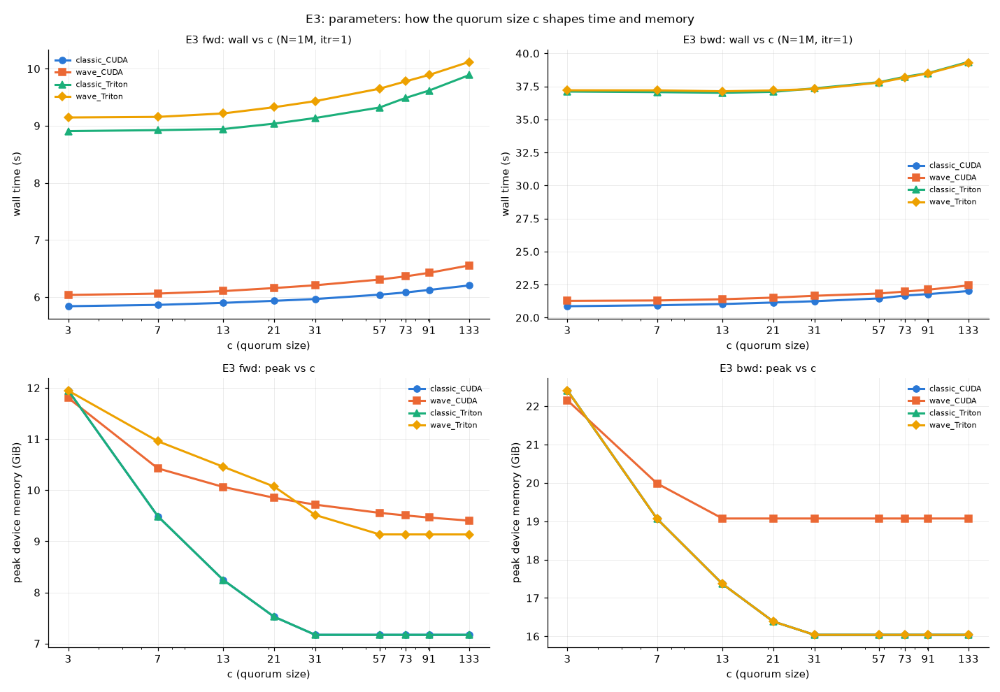

## E4: parameters: depth x accumulator placement at one size (device-resident Q/K/V)

| N | D | dtype | dir | c | itr | acc | qkv | W | arm | engine that ran | wall s | min s | peak GiB | workspace | host GiB | /FA-2 | /SDPA | ref | rel vs ref | grads | fp64 (x ref) | fp64 dq (x ref) | status |
|---|---|---|---|---|---|---|---|---|---|---|---|---|---|---|---|---|---|---|---|---|---|---|---|
| 1M | 64 | fp16 | fwd | 7 | 1 | cpu | device | - | classic_CUDA | classic/cuda itr=1 n_sub=7 | 6.687 | 6.657 | 5.61 | 2.60 | 6.83 | 1.109 | 1.058 | FA-2 | 2.7e-04 | - | 1.6e-05 (0.64) | - | ok |
| 1M | 64 | fp16 | fwd | 7 | 1 | gpu | device | - | classic_CUDA | classic/cuda itr=1 n_sub=7 | 5.854 | 5.849 | 9.49 | 6.48 | 0.08 | 0.971 | 0.926 | FA-2 | 2.7e-04 | - | 1.6e-05 (0.64) | - | ok |
| 1M | 64 | fp16 | fwd | 7 | 2 | cpu | device | - | classic_CUDA | classic/cuda itr=2 n_sub=49 | 8.894 | 8.856 | 5.01 | 2.00 | 4.94 | 1.475 | 1.408 | FA-2 | 3.3e-04 | - | 1.4e-05 (0.56) | - | ok |
| 1M | 64 | fp16 | fwd | 7 | 2 | gpu | device | - | classic_CUDA | classic/cuda itr=2 n_sub=49 | 6.076 | 6.075 | 7.17 | 4.16 | 0.22 | 1.007 | 0.962 | FA-2 | 3.3e-04 | - | 1.4e-05 (0.56) | - | ok |
| 1M | 64 | fp16 | fwd | 7 | 1 | cpu | device | - | wave_CUDA | wave/cuda itr=1 n_sub=7 waves=7 | 6.917 | 6.916 | 6.08 | 3.07 | 8.43 | 1.147 | 1.095 | FA-2 | 2.7e-04 | - | 1.6e-05 (0.64) | - | ok |
| 1M | 64 | fp16 | fwd | 7 | 1 | gpu | device | - | wave_CUDA | wave/cuda itr=1 n_sub=7 waves=7 | 6.048 | 6.044 | 10.43 | 7.42 | 0.06 | 1.003 | 0.957 | FA-2 | 2.7e-04 | - | 1.6e-05 (0.64) | - | ok |
| 1M | 64 | fp16 | fwd | 7 | 2 | cpu | device | - | wave_CUDA | wave/cuda itr=2 n_sub=49 waves=49 | 7.645 | 7.640 | 4.32 | 1.32 | 7.38 | 1.268 | 1.210 | FA-2 | 3.3e-04 | - | 1.4e-05 (0.56) | - | ok |
| 1M | 64 | fp16 | fwd | 7 | 2 | gpu | device | - | wave_CUDA | wave/cuda itr=2 n_sub=49 waves=49 | 6.384 | 6.375 | 9.69 | 6.68 | 0.16 | 1.058 | 1.010 | FA-2 | 3.3e-04 | - | 1.4e-05 (0.56) | - | ok |
| 1M | 64 | fp16 | fwd | 7 | 1 | cpu | device | - | classic_Triton | classic/triton itr=1 n_sub=7 | 9.861 | 9.856 | 5.18 | 2.17 | 6.81 | 1.635 | 1.561 | FA-2 | 4.3e-04 | - | 1.6e-05 (0.65) | - | ok |
| 1M | 64 | fp16 | fwd | 7 | 1 | gpu | device | - | classic_Triton | classic/triton itr=1 n_sub=7 | 8.925 | 8.921 | 9.49 | 6.48 | 0.08 | 1.480 | 1.412 | FA-2 | 4.3e-04 | - | 1.6e-05 (0.65) | - | ok |
| 1M | 64 | fp16 | fwd | 7 | 2 | cpu | device | - | classic_Triton | classic/triton itr=2 n_sub=49 | 10.850 | 10.839 | 5.01 | 2.00 | 4.98 | 1.799 | 1.717 | FA-2 | 4.4e-04 | - | 1.4e-05 (0.56) | - | ok |
| 1M | 64 | fp16 | fwd | 7 | 2 | gpu | device | - | classic_Triton | classic/triton itr=2 n_sub=49 | 9.293 | 9.291 | 7.17 | 4.16 | 0.22 | 1.541 | 1.471 | FA-2 | 4.4e-04 | - | 1.4e-05 (0.56) | - | ok |
| 1M | 64 | fp16 | fwd | 7 | 1 | cpu | device | - | wave_Triton | wave/triton itr=1 n_sub=7 waves=7 | 10.090 | 10.077 | 7.75 | 4.74 | 8.44 | 1.673 | 1.597 | FA-2 | 4.3e-04 | - | 1.6e-05 (0.65) | - | ok |
| 1M | 64 | fp16 | fwd | 7 | 1 | gpu | device | - | wave_Triton | wave/triton itr=1 n_sub=7 waves=7 | 9.153 | 9.153 | 10.96 | 7.95 | 0.06 | 1.518 | 1.449 | FA-2 | 4.3e-04 | - | 1.6e-05 (0.65) | - | ok |
| 1M | 64 | fp16 | fwd | 7 | 2 | cpu | device | - | wave_Triton | wave/triton itr=2 n_sub=49 waves=49 | 11.048 | 11.047 | 5.68 | 2.67 | 7.43 | 1.832 | 1.748 | FA-2 | 4.4e-04 | - | 1.4e-05 (0.56) | - | ok |
| 1M | 64 | fp16 | fwd | 7 | 2 | gpu | device | - | wave_Triton | wave/triton itr=2 n_sub=49 waves=49 | 9.657 | 9.655 | 9.39 | 6.39 | 0.16 | 1.601 | 1.528 | FA-2 | 4.4e-04 | - | 1.4e-05 (0.56) | - | ok |
| 1M | 64 | fp16 | bwd | 7 | 1 | cpu | device | - | classic_CUDA | classic/cuda itr=1 n_sub=7 | 23.094 | 23.025 | 11.37 | 7.36 | 14.21 | 1.098 | 1.023 | FA-2 | 2.7e-04 | 4.3e-04 | 1.6e-05 (0.64) | 4.9e-04 (1.02) | ok |
| 1M | 64 | fp16 | bwd | 7 | 1 | gpu | device | - | classic_CUDA | classic/cuda itr=1 n_sub=7 | 21.097 | 21.088 | 19.06 | 15.06 | 0.11 | 1.003 | 0.934 | FA-2 | 2.7e-04 | 4.3e-04 | 1.6e-05 (0.64) | 4.9e-04 (1.02) | ok |
| 1M | 64 | fp16 | bwd | 7 | 2 | cpu | device | - | classic_CUDA | classic/cuda itr=2 n_sub=49 | 25.722 | 25.711 | 10.04 | 6.03 | 11.29 | 1.223 | 1.139 | FA-2 | 3.3e-04 | 4.7e-04 | 1.4e-05 (0.56) | 5.0e-04 (1.04) | ok |
| 1M | 64 | fp16 | bwd | 7 | 2 | gpu | device | - | classic_CUDA | classic/cuda itr=2 n_sub=49 | 21.712 | 21.707 | 16.04 | 12.03 | 0.22 | 1.033 | 0.962 | FA-2 | 3.3e-04 | 4.7e-04 | 1.4e-05 (0.56) | 5.0e-04 (1.04) | ok |
| 1M | 64 | fp16 | bwd | 7 | 1 | cpu | device | - | wave_CUDA | wave/cuda itr=1 n_sub=7 waves=7 | 21.318 | 21.315 | 19.99 | 15.98 | 0.07 | 1.014 | 0.944 | FA-2 | 2.7e-04 | 4.4e-04 | 1.6e-05 (0.64) | 4.9e-04 (1.02) | ok |
| 1M | 64 | fp16 | bwd | 7 | 1 | gpu | device | - | wave_CUDA | wave/cuda itr=1 n_sub=7 waves=7 | 21.314 | 21.314 | 19.99 | 15.98 | 0.07 | 1.014 | 0.944 | FA-2 | 2.7e-04 | 4.4e-04 | 1.6e-05 (0.64) | 4.9e-04 (1.02) | ok |
| 1M | 64 | fp16 | bwd | 7 | 2 | cpu | device | - | wave_CUDA | wave/cuda itr=2 n_sub=49 waves=49 | 22.120 | 22.120 | 19.07 | 15.06 | 0.16 | 1.052 | 0.980 | FA-2 | 3.3e-04 | 4.8e-04 | 1.4e-05 (0.56) | 5.0e-04 (1.04) | ok |
| 1M | 64 | fp16 | bwd | 7 | 2 | gpu | device | - | wave_CUDA | wave/cuda itr=2 n_sub=49 waves=49 | 22.119 | 22.119 | 19.07 | 15.06 | 0.17 | 1.052 | 0.980 | FA-2 | 3.3e-04 | 4.8e-04 | 1.4e-05 (0.56) | 5.0e-04 (1.04) | ok |
| 1M | 64 | fp16 | bwd | 7 | 1 | cpu | device | - | classic_Triton | classic/triton itr=1 n_sub=7 | 39.136 | 39.082 | 11.78 | 7.77 | 14.21 | 1.861 | 1.733 | FA-2 | 4.3e-04 | 1.2e-03 | 1.6e-05 (0.65) | 5.3e-04 (1.10) | ok |
| 1M | 64 | fp16 | bwd | 7 | 1 | gpu | device | - | classic_Triton | classic/triton itr=1 n_sub=7 | 36.973 | 36.957 | 19.06 | 15.06 | 0.08 | 1.759 | 1.638 | FA-2 | 4.3e-04 | 1.2e-03 | 1.6e-05 (0.65) | 5.3e-04 (1.10) | ok |
| 1M | 64 | fp16 | bwd | 7 | 2 | cpu | device | - | classic_Triton | classic/triton itr=2 n_sub=49 | 40.291 | 40.274 | 10.04 | 6.03 | 11.29 | 1.916 | 1.784 | FA-2 | 4.4e-04 | 6.4e-04 | 1.4e-05 (0.56) | 5.0e-04 (1.06) | ok |
| 1M | 64 | fp16 | bwd | 7 | 2 | gpu | device | - | classic_Triton | classic/triton itr=2 n_sub=49 | 37.737 | 37.734 | 16.04 | 12.03 | 0.22 | 1.795 | 1.671 | FA-2 | 4.4e-04 | 6.4e-04 | 1.4e-05 (0.56) | 5.0e-04 (1.06) | ok |
| 1M | 64 | fp16 | bwd | 7 | 1 | cpu | device | - | wave_Triton | classic/triton itr=1 n_sub=7 | 39.064 | 39.060 | 11.78 | 7.77 | 14.23 | 1.858 | 1.730 | FA-2 | 4.3e-04 | 1.2e-03 | 1.6e-05 (0.65) | 5.3e-04 (1.10) | ok |
| 1M | 64 | fp16 | bwd | 7 | 1 | gpu | device | - | wave_Triton | classic/triton itr=1 n_sub=7 | 36.982 | 36.966 | 19.06 | 15.06 | 0.08 | 1.759 | 1.638 | FA-2 | 4.3e-04 | 1.2e-03 | 1.6e-05 (0.65) | 5.3e-04 (1.10) | ok |
| 1M | 64 | fp16 | bwd | 7 | 2 | cpu | device | - | wave_Triton | classic/triton itr=2 n_sub=49 | 40.399 | 40.385 | 10.04 | 6.03 | 11.39 | 1.921 | 1.789 | FA-2 | 4.4e-04 | 6.4e-04 | 1.4e-05 (0.56) | 5.0e-04 (1.06) | ok |
| 1M | 64 | fp16 | bwd | 7 | 2 | gpu | device | - | wave_Triton | classic/triton itr=2 n_sub=49 | 37.737 | 37.734 | 16.04 | 12.03 | 0.22 | 1.795 | 1.671 | FA-2 | 4.4e-04 | 6.4e-04 | 1.4e-05 (0.56) | 5.0e-04 (1.06) | ok |

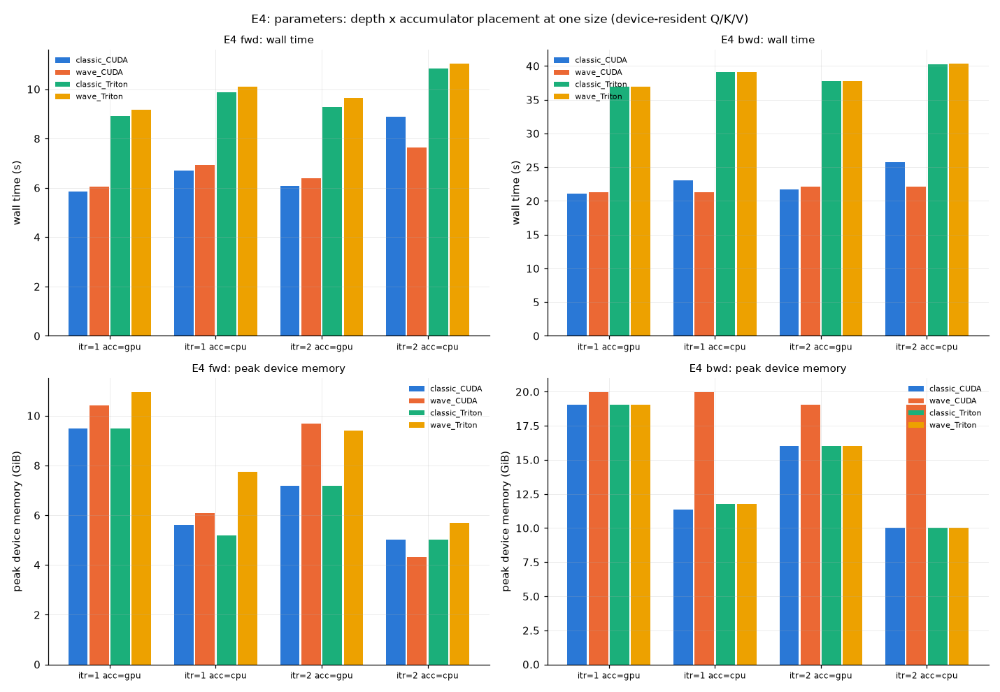

## E5: parameters: the wave budget W (subproblems per launch)

| N | D | dtype | dir | c | itr | acc | qkv | W | arm | engine that ran | wall s | min s | peak GiB | workspace | host GiB | /FA-2 | /SDPA | ref | rel vs ref | grads | fp64 (x ref) | fp64 dq (x ref) | status |
|---|---|---|---|---|---|---|---|---|---|---|---|---|---|---|---|---|---|---|---|---|---|---|---|
| 1M | 64 | fp16 | fwd | 73 | 1 | gpu | device | W=1x | wave_CUDA | wave/cuda itr=1 n_sub=73 waves=73 | 6.368 | 6.366 | 9.51 | 6.50 | 0.00 | 1.056 | 1.008 | FA-2 | 3.6e-04 | - | 1.3e-05 (0.54) | - | ok |
| 1M | 64 | fp16 | fwd | 73 | 1 | gpu | device | W=2x | wave_CUDA | wave/cuda itr=1 n_sub=73 waves=37 | 6.336 | 6.334 | 9.51 | 6.50 | 0.00 | 1.051 | 1.003 | FA-2 | 3.6e-04 | - | 1.3e-05 (0.54) | - | ok |
| 1M | 64 | fp16 | fwd | 73 | 1 | gpu | device | W=4x | wave_CUDA | wave/cuda itr=1 n_sub=73 waves=19 | 6.339 | 6.336 | 10.59 | 7.58 | 0.00 | 1.051 | 1.003 | FA-2 | 3.6e-04 | - | 1.3e-05 (0.54) | - | ok |
| 1M | 64 | fp16 | fwd | 73 | 1 | gpu | device | W=8x | wave_CUDA | wave/cuda itr=1 n_sub=73 waves=10 | 6.323 | 6.301 | 14.08 | 11.07 | 0.01 | 1.048 | 1.001 | FA-2 | 3.6e-04 | - | 1.3e-05 (0.54) | - | ok |
| 1M | 64 | fp16 | fwd | 73 | 1 | gpu | device | W=16x | wave_CUDA | wave/cuda itr=1 n_sub=73 waves=5 | 6.302 | 6.301 | 21.03 | 18.02 | 0.03 | 1.045 | 0.997 | FA-2 | 3.6e-04 | - | 1.3e-05 (0.54) | - | ok |
| 1M | 64 | fp16 | fwd | 73 | 1 | gpu | device | W=1x | wave_Triton | wave/triton itr=1 n_sub=73 waves=73 | 9.795 | 9.793 | 9.14 | 6.13 | 0.00 | 1.624 | 1.550 | FA-2 | 4.4e-04 | - | 1.3e-05 (0.55) | - | ok |
| 1M | 64 | fp16 | fwd | 73 | 1 | gpu | device | W=2x | wave_Triton | wave/triton itr=1 n_sub=73 waves=37 | 9.799 | 9.797 | 10.53 | 7.52 | 0.00 | 1.625 | 1.551 | FA-2 | 4.4e-04 | - | 1.3e-05 (0.55) | - | ok |
| 1M | 64 | fp16 | fwd | 73 | 1 | gpu | device | W=4x | wave_Triton | wave/triton itr=1 n_sub=73 waves=19 | 9.764 | 9.753 | 12.76 | 9.75 | 0.00 | 1.619 | 1.545 | FA-2 | 4.4e-04 | - | 1.3e-05 (0.55) | - | ok |
| 1M | 64 | fp16 | fwd | 73 | 1 | gpu | device | W=8x | wave_Triton | wave/triton itr=1 n_sub=73 waves=10 | 9.706 | 9.706 | 16.37 | 13.36 | 0.01 | 1.609 | 1.536 | FA-2 | 4.4e-04 | - | 1.3e-05 (0.55) | - | ok |
| 1M | 64 | fp16 | fwd | 73 | 1 | gpu | device | W=16x | wave_Triton | wave/triton itr=1 n_sub=73 waves=5 | 9.622 | 9.618 | 21.50 | 18.49 | 0.03 | 1.595 | 1.523 | FA-2 | 4.4e-04 | - | 1.3e-05 (0.55) | - | ok |
| 1M | 64 | fp16 | bwd | 73 | 1 | gpu | device | W=1x | wave_CUDA | wave/cuda itr=1 n_sub=73 waves=73 | 22.102 | 22.100 | 19.07 | 15.06 | 0.00 | 1.051 | 0.979 | FA-2 | 3.6e-04 | 4.8e-04 | 1.3e-05 (0.54) | 5.1e-04 (1.06) | ok |
| 1M | 64 | fp16 | bwd | 73 | 1 | gpu | device | W=2x | wave_CUDA | wave/cuda itr=1 n_sub=73 waves=37 | 22.031 | 22.030 | 19.07 | 15.06 | 0.01 | 1.048 | 0.976 | FA-2 | 3.6e-04 | 4.8e-04 | 1.3e-05 (0.54) | 5.1e-04 (1.06) | ok |
| 1M | 64 | fp16 | bwd | 73 | 1 | gpu | device | W=4x | wave_CUDA | wave/cuda itr=1 n_sub=73 waves=19 | 21.979 | 21.976 | 20.58 | 16.57 | 0.01 | 1.045 | 0.973 | FA-2 | 3.6e-04 | 4.8e-04 | 1.3e-05 (0.54) | 5.1e-04 (1.06) | ok |
| 1M | 64 | fp16 | bwd | 73 | 1 | gpu | device | W=8x | wave_CUDA | wave/cuda itr=1 n_sub=73 waves=10 | 21.930 | 21.930 | 25.10 | 21.09 | 0.03 | 1.043 | 0.971 | FA-2 | 3.6e-04 | 4.8e-04 | 1.3e-05 (0.54) | 5.1e-04 (1.06) | ok |
| 1M | 64 | fp16 | bwd | 73 | 1 | gpu | device | W=16x | wave_CUDA | wave/cuda itr=1 n_sub=73 waves=5 | 21.797 | 21.791 | 34.10 | 30.10 | 0.08 | 1.037 | 0.965 | FA-2 | 3.6e-04 | 4.8e-04 | 1.3e-05 (0.54) | 5.1e-04 (1.06) | ok |
| 1M | 64 | fp16 | bwd | 73 | 1 | gpu | device | W=1x | wave_Triton | classic/triton itr=1 n_sub=73 | 38.078 | 38.076 | 16.04 | 12.03 | 0.15 | 1.811 | 1.686 | FA-2 | 4.4e-04 | 5.6e-04 | 1.3e-05 (0.55) | 5.1e-04 (1.07) | ok |
| 1M | 64 | fp16 | bwd | 73 | 1 | gpu | device | W=2x | wave_Triton | classic/triton itr=1 n_sub=73 | 38.091 | 38.090 | 16.04 | 12.03 | 0.15 | 1.812 | 1.687 | FA-2 | 4.4e-04 | 5.6e-04 | 1.3e-05 (0.55) | 5.1e-04 (1.07) | ok |
| 1M | 64 | fp16 | bwd | 73 | 1 | gpu | device | W=4x | wave_Triton | classic/triton itr=1 n_sub=73 | 38.081 | 38.080 | 16.04 | 12.03 | 0.15 | 1.811 | 1.687 | FA-2 | 4.4e-04 | 5.6e-04 | 1.3e-05 (0.55) | 5.1e-04 (1.07) | ok |
| 1M | 64 | fp16 | bwd | 73 | 1 | gpu | device | W=8x | wave_Triton | classic/triton itr=1 n_sub=73 | 38.081 | 38.081 | 16.04 | 12.03 | 0.15 | 1.811 | 1.687 | FA-2 | 4.4e-04 | 5.6e-04 | 1.3e-05 (0.55) | 5.1e-04 (1.07) | ok |
| 1M | 64 | fp16 | bwd | 73 | 1 | gpu | device | W=16x | wave_Triton | classic/triton itr=1 n_sub=73 | 38.094 | 38.094 | 16.04 | 12.03 | 0.15 | 1.812 | 1.687 | FA-2 | 4.4e-04 | 5.6e-04 | 1.3e-05 (0.55) | 5.1e-04 (1.07) | ok |

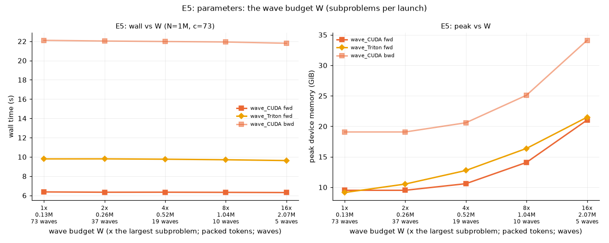

## E6: parameters: precision and head dim (performance; E0 has their correctness)

| N | D | dtype | dir | c | itr | acc | qkv | W | arm | engine that ran | wall s | min s | peak GiB | workspace | host GiB | /FA-2 | /SDPA | ref | rel vs ref | grads | fp64 (x ref) | fp64 dq (x ref) | status |
|---|---|---|---|---|---|---|---|---|---|---|---|---|---|---|---|---|---|---|---|---|---|---|---|
| 1M | 64 | bf16 | fwd | - | - | - | device | - | FA-2 | monolithic | 5.827 | 5.824 | 4.04 | 1.03 | 0.00 | 1.000 | 0.950 | - | - | - | 1.0e-04 | - | ok |
| 1M | 64 | bf16 | fwd | - | - | - | device | - | SDPA | monolithic | 6.133 | 6.128 | 4.04 | 1.03 | 0.00 | 1.052 | 1.000 | FA-2 | 9.2e-05 | - | 1.0e-04 (1.00) | - | ok |
| 1M | 64 | bf16 | fwd | 7 | 1 | gpu | device | - | classic_CUDA | classic/cuda itr=1 n_sub=7 | 5.705 | 5.704 | 9.49 | 6.48 | 0.08 | 0.979 | 0.930 | FA-2 | 1.0e-03 | - | 1.0e-04 (0.98) | - | ok |
| 1M | 64 | bf16 | fwd | 7 | 1 | gpu | device | - | wave_CUDA | wave/cuda itr=1 n_sub=7 waves=7 | 5.890 | 5.890 | 10.43 | 7.42 | 0.06 | 1.011 | 0.961 | FA-2 | 1.0e-03 | - | 1.0e-04 (0.98) | - | ok |
| 1M | 64 | bf16 | fwd | 7 | 1 | gpu | device | - | classic_Triton | classic/triton itr=1 n_sub=7 | 8.889 | 8.888 | 9.49 | 6.48 | 0.08 | 1.525 | 1.449 | FA-2 | 2.5e-03 | - | 1.0e-04 (0.99) | - | ok |
| 1M | 64 | bf16 | fwd | 7 | 1 | gpu | device | - | wave_Triton | wave/triton itr=1 n_sub=7 waves=7 | 9.135 | 9.133 | 10.96 | 7.95 | 0.06 | 1.568 | 1.490 | FA-2 | 2.5e-03 | - | 1.0e-04 (0.99) | - | ok |
| 1M | 64 | bf16 | bwd | - | - | - | device | - | FA-2 | monolithic | 20.975 | 20.969 | 10.07 | 6.06 | 0.00 | 1.000 | 0.931 | - | - | - | 1.0e-04 | 2.4e-03 | ok |
| 1M | 64 | bf16 | bwd | - | - | - | device | - | SDPA | monolithic | 22.525 | 22.525 | 12.07 | 8.06 | 0.00 | 1.074 | 1.000 | FA-2 | 9.2e-05 | 2.2e-04 | 1.0e-04 (1.00) | 2.4e-03 (1.00) | ok |
| 1M | 64 | bf16 | bwd | 7 | 1 | gpu | device | - | classic_CUDA | classic/cuda itr=1 n_sub=7 | 20.891 | 20.891 | 19.06 | 15.06 | 0.10 | 0.996 | 0.927 | FA-2 | 1.0e-03 | 2.8e-03 | 1.0e-04 (0.98) | 2.6e-03 (1.08) | ok |
| 1M | 64 | bf16 | bwd | 7 | 1 | gpu | device | - | wave_CUDA | wave/cuda itr=1 n_sub=7 waves=7 | 21.121 | 21.116 | 19.99 | 15.98 | 0.07 | 1.007 | 0.938 | FA-2 | 1.0e-03 | 2.9e-03 | 1.0e-04 (0.98) | 2.6e-03 (1.07) | ok |
| 1M | 64 | bf16 | bwd | 7 | 1 | gpu | device | - | classic_Triton | classic/triton itr=1 n_sub=7 | 36.934 | 36.913 | 19.06 | 15.06 | 0.08 | 1.761 | 1.640 | FA-2 | 2.5e-03 | 3.1e-03 | 1.0e-04 (0.99) | 2.6e-03 (1.08) | ok |
| 1M | 64 | bf16 | bwd | 7 | 1 | gpu | device | - | wave_Triton | classic/triton itr=1 n_sub=7 | 36.923 | 36.908 | 19.06 | 15.06 | 0.08 | 1.760 | 1.639 | FA-2 | 2.5e-03 | 3.1e-03 | 1.0e-04 (0.99) | 2.6e-03 (1.08) | ok |
| 1M | 64 | fp16 | fwd | - | - | - | device | - | FA-2 | monolithic | 5.945 | 5.945 | 4.04 | 1.03 | 0.00 | 1.000 | 0.953 | - | - | - | 2.5e-05 | - | ok |
| 1M | 64 | fp16 | fwd | - | - | - | device | - | SDPA | monolithic | 6.240 | 6.236 | 4.04 | 1.03 | 0.00 | 1.050 | 1.000 | FA-2 | 2.6e-05 | - | 2.5e-05 (1.00) | - | ok |
| 1M | 64 | fp16 | fwd | 7 | 1 | gpu | device | - | classic_CUDA | classic/cuda itr=1 n_sub=7 | 5.749 | 5.746 | 9.49 | 6.48 | 0.08 | 0.967 | 0.921 | FA-2 | 2.7e-04 | - | 1.6e-05 (0.64) | - | ok |
| 1M | 64 | fp16 | fwd | 7 | 1 | gpu | device | - | wave_CUDA | wave/cuda itr=1 n_sub=7 waves=7 | 5.977 | 5.974 | 10.43 | 7.42 | 0.06 | 1.005 | 0.958 | FA-2 | 2.7e-04 | - | 1.6e-05 (0.64) | - | ok |
| 1M | 64 | fp16 | fwd | 7 | 1 | gpu | device | - | classic_Triton | classic/triton itr=1 n_sub=7 | 8.898 | 8.898 | 9.49 | 6.48 | 0.08 | 1.497 | 1.426 | FA-2 | 4.3e-04 | - | 1.6e-05 (0.65) | - | ok |
| 1M | 64 | fp16 | fwd | 7 | 1 | gpu | device | - | wave_Triton | wave/triton itr=1 n_sub=7 waves=7 | 9.140 | 9.140 | 10.96 | 7.95 | 0.06 | 1.537 | 1.465 | FA-2 | 4.3e-04 | - | 1.6e-05 (0.65) | - | ok |
| 1M | 64 | fp16 | bwd | - | - | - | device | - | FA-2 | monolithic | 21.081 | 21.079 | 10.07 | 6.06 | 0.00 | 1.000 | 0.932 | - | - | - | 2.5e-05 | 4.8e-04 | ok |
| 1M | 64 | fp16 | bwd | - | - | - | device | - | SDPA | monolithic | 22.624 | 22.614 | 12.07 | 8.06 | 0.00 | 1.073 | 1.000 | FA-2 | 2.6e-05 | 5.6e-05 | 2.5e-05 (1.00) | 4.8e-04 (1.00) | ok |
| 1M | 64 | fp16 | bwd | 7 | 1 | gpu | device | - | classic_CUDA | classic/cuda itr=1 n_sub=7 | 20.956 | 20.954 | 19.06 | 15.06 | 0.11 | 0.994 | 0.926 | FA-2 | 2.7e-04 | 4.3e-04 | 1.6e-05 (0.64) | 4.9e-04 (1.02) | ok |
| 1M | 64 | fp16 | bwd | 7 | 1 | gpu | device | - | wave_CUDA | wave/cuda itr=1 n_sub=7 waves=7 | 21.205 | 21.195 | 19.99 | 15.98 | 0.07 | 1.006 | 0.937 | FA-2 | 2.7e-04 | 4.4e-04 | 1.6e-05 (0.64) | 4.9e-04 (1.02) | ok |
| 1M | 64 | fp16 | bwd | 7 | 1 | gpu | device | - | classic_Triton | classic/triton itr=1 n_sub=7 | 37.046 | 37.032 | 19.06 | 15.06 | 0.08 | 1.757 | 1.637 | FA-2 | 4.3e-04 | 1.2e-03 | 1.6e-05 (0.65) | 5.3e-04 (1.10) | ok |
| 1M | 64 | fp16 | bwd | 7 | 1 | gpu | device | - | wave_Triton | classic/triton itr=1 n_sub=7 | 37.360 | 37.354 | 19.06 | 15.06 | 0.08 | 1.772 | 1.651 | FA-2 | 4.3e-04 | 1.2e-03 | 1.6e-05 (0.65) | 5.3e-04 (1.10) | ok |
| 1M | 128 | bf16 | fwd | - | - | - | device | - | FA-2 | monolithic | 10.500 | 10.491 | 8.04 | 2.03 | 0.00 | 1.000 | 0.932 | - | - | - | 1.1e-04 | - | ok |
| 1M | 128 | bf16 | fwd | - | - | - | device | - | SDPA | monolithic | 11.264 | 11.261 | 8.04 | 2.03 | 0.00 | 1.073 | 1.000 | FA-2 | 9.0e-05 | - | 1.1e-04 (1.00) | - | ok |
| 1M | 128 | bf16 | fwd | 7 | 1 | gpu | device | - | classic_CUDA | classic/cuda itr=1 n_sub=7 | 10.039 | 10.039 | 18.78 | 12.77 | 0.08 | 0.956 | 0.891 | FA-2 | 9.9e-04 | - | 1.0e-04 (0.98) | - | ok |
| 1M | 128 | bf16 | fwd | 7 | 1 | gpu | device | - | wave_CUDA | wave/cuda itr=1 n_sub=7 waves=7 | 10.239 | 10.239 | 20.71 | 14.70 | 0.06 | 0.975 | 0.909 | FA-2 | 9.9e-04 | - | 1.0e-04 (0.98) | - | ok |
| 1M | 128 | bf16 | fwd | 7 | 1 | gpu | device | - | classic_Triton | classic/triton itr=1 n_sub=7 | 24.050 | 24.049 | 18.78 | 12.77 | 0.08 | 2.291 | 2.135 | FA-2 | 2.6e-03 | - | 1.1e-04 (1.00) | - | ok |
| 1M | 128 | bf16 | fwd | 7 | 1 | gpu | device | - | wave_Triton | wave/triton itr=1 n_sub=7 waves=7 | 24.482 | 24.478 | 21.67 | 15.66 | 0.11 | 2.332 | 2.173 | FA-2 | 2.6e-03 | - | 1.1e-04 (1.00) | - | ok |
| 1M | 128 | bf16 | bwd | - | - | - | device | - | FA-2 | monolithic | 38.394 | 38.312 | 20.07 | 12.06 | 0.00 | 1.000 | 0.956 | - | - | - | 1.1e-04 | 2.4e-03 | ok |
| 1M | 128 | bf16 | bwd | - | - | - | device | - | SDPA | monolithic | 40.162 | 40.157 | 24.07 | 16.06 | 0.00 | 1.046 | 1.000 | FA-2 | 9.0e-05 | 2.2e-04 | 1.1e-04 (1.00) | 2.4e-03 (1.00) | ok |
| 1M | 128 | bf16 | bwd | 7 | 1 | gpu | device | - | classic_CUDA | classic/cuda itr=1 n_sub=7 | 37.616 | 37.615 | 38.07 | 30.06 | 0.09 | 0.980 | 0.937 | FA-2 | 9.9e-04 | 2.8e-03 | 1.0e-04 (0.98) | 2.6e-03 (1.08) | ok |
| 1M | 128 | bf16 | bwd | 7 | 1 | gpu | device | - | wave_CUDA | wave/cuda itr=1 n_sub=7 waves=7 | 37.881 | 37.794 | 39.84 | 31.83 | 0.07 | 0.987 | 0.943 | FA-2 | 9.9e-04 | 3.0e-03 | 1.0e-04 (0.98) | 2.6e-03 (1.07) | ok |
| 1M | 128 | fp16 | fwd | - | - | - | device | - | FA-2 | monolithic | 10.870 | 10.859 | 8.04 | 2.03 | 0.00 | 1.000 | 0.939 | - | - | - | 2.5e-05 | - | ok |
| 1M | 128 | fp16 | fwd | - | - | - | device | - | SDPA | monolithic | 11.574 | 11.568 | 8.04 | 2.03 | 0.00 | 1.065 | 1.000 | FA-2 | 2.6e-05 | - | 2.5e-05 (1.00) | - | ok |
| 1M | 128 | fp16 | fwd | 7 | 1 | gpu | device | - | classic_CUDA | classic/cuda itr=1 n_sub=7 | 10.117 | 10.112 | 18.78 | 12.77 | 0.08 | 0.931 | 0.874 | FA-2 | 2.7e-04 | - | 1.6e-05 (0.65) | - | ok |
| 1M | 128 | fp16 | fwd | 7 | 1 | gpu | device | - | wave_CUDA | wave/cuda itr=1 n_sub=7 waves=7 | 10.317 | 10.313 | 20.71 | 14.70 | 0.06 | 0.949 | 0.891 | FA-2 | 2.7e-04 | - | 1.6e-05 (0.65) | - | ok |
| 1M | 128 | fp16 | fwd | 7 | 1 | gpu | device | - | classic_Triton | classic/triton itr=1 n_sub=7 | 24.083 | 24.080 | 18.78 | 12.77 | 0.08 | 2.215 | 2.081 | FA-2 | 4.3e-04 | - | 1.6e-05 (0.65) | - | ok |
| 1M | 128 | fp16 | fwd | 7 | 1 | gpu | device | - | wave_Triton | wave/triton itr=1 n_sub=7 waves=7 | 24.520 | 24.516 | 21.67 | 15.66 | 0.06 | 2.256 | 2.119 | FA-2 | 4.3e-04 | - | 1.6e-05 (0.65) | - | ok |
| 1M | 128 | fp16 | bwd | - | - | - | device | - | FA-2 | monolithic | 38.378 | 38.365 | 20.07 | 12.06 | 0.00 | 1.000 | 0.954 | - | - | - | 2.5e-05 | 3.8e-04 | ok |
| 1M | 128 | fp16 | bwd | - | - | - | device | - | SDPA | monolithic | 40.243 | 40.238 | 24.07 | 16.06 | 0.00 | 1.049 | 1.000 | FA-2 | 2.6e-05 | 5.7e-05 | 2.5e-05 (1.00) | 3.8e-04 (1.00) | ok |
| 1M | 128 | fp16 | bwd | 7 | 1 | gpu | device | - | classic_CUDA | classic/cuda itr=1 n_sub=7 | 37.391 | 37.388 | 38.07 | 30.06 | 0.11 | 0.974 | 0.929 | FA-2 | 2.7e-04 | 4.3e-04 | 1.6e-05 (0.65) | 3.9e-04 (1.04) | ok |
| 1M | 128 | fp16 | bwd | 7 | 1 | gpu | device | - | wave_CUDA | wave/cuda itr=1 n_sub=7 waves=7 | 37.884 | 37.843 | 39.84 | 31.83 | 0.07 | 0.987 | 0.941 | FA-2 | 2.7e-04 | 4.4e-04 | 1.6e-05 (0.65) | 3.9e-04 (1.03) | ok |

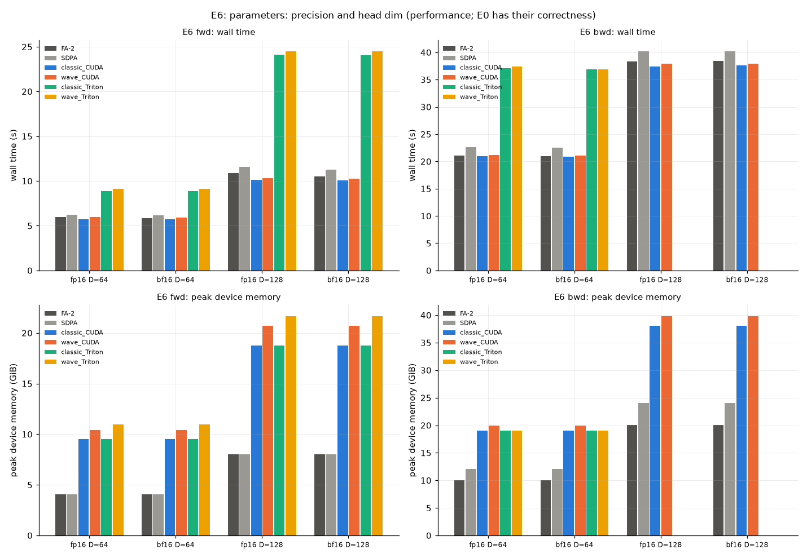

## E9: chunk reuse in the host-resident forward: the shared chunk between consecutive subproblems kept on the device (the classic engine's pool of 3 / 4 / 7 slots) against a flush-and-reload of every subproblem's chunks, and the wave engine's pool at the minimum (3) against all chunks resident (7, what it sizes itself to with room): transfers, time and device memory vs N and head dim

| N | D | dtype | dir | c | itr | acc | qkv | W | arm | engine that ran | wall s | min s | peak GiB | workspace | host GiB | /FA-2 | /SDPA | ref | rel vs ref | grads | fp64 (x ref) | fp64 dq (x ref) | status |
|---|---|---|---|---|---|---|---|---|---|---|---|---|---|---|---|---|---|---|---|---|---|---|---|
| 256K | 64 | fp16 | fwd | 7 | 1 | cpu | host | pool=3 | classic_CUDA | classic/cuda itr=1 n_sub=7 | 0.948 | 0.948 | 0.66 | 0.65 | 2.02 | 2.614 | 2.475 | - | - | - | 2.7e-05 | - | ok |
| 256K | 64 | fp16 | fwd | 7 | 1 | cpu | host | pool=3-np1 | classic_CUDA | classic/cuda itr=1 n_sub=7 | 0.883 | 0.883 | 0.66 | 0.65 | 2.02 | 2.433 | 2.304 | - | - | - | 2.7e-05 | - | ok |
| 256K | 64 | fp16 | fwd | 7 | 1 | cpu | host | pool=4 | classic_CUDA | classic/cuda itr=1 n_sub=7 | 0.941 | 0.941 | 0.77 | 0.76 | 2.03 | 2.593 | 2.455 | - | - | - | 2.7e-05 | - | ok |
| 256K | 64 | fp16 | fwd | 7 | 1 | cpu | host | pool=7 | classic_CUDA | classic/cuda itr=1 n_sub=7 | 0.942 | 0.942 | 1.09 | 1.08 | 2.03 | 2.596 | 2.458 | - | - | - | 2.7e-05 | - | ok |
| 256K | 64 | fp16 | fwd | 7 | 1 | cpu | host | pool=flush | classic_CUDA | classic/cuda itr=1 n_sub=7 | 1.089 | 1.089 | 0.66 | 0.65 | 2.04 | 3.001 | 2.841 | - | - | - | 2.7e-05 | - | ok |
| 256K | 64 | fp16 | fwd | 7 | 1 | cpu | host | pool=3 | wave_CUDA | wave/cuda itr=1 n_sub=7 waves=7 | 0.766 | 0.766 | 0.77 | 0.77 | 2.19 | 2.113 | 2.000 | - | - | - | 2.7e-05 | - | ok |
| 256K | 64 | fp16 | fwd | 7 | 1 | cpu | host | pool=7 | wave_CUDA | wave/cuda itr=1 n_sub=7 waves=7 | 0.736 | 0.736 | 1.20 | 1.20 | 2.22 | 2.029 | 1.921 | - | - | - | 2.7e-05 | - | ok |
| 256K | 128 | fp16 | fwd | 7 | 1 | cpu | host | pool=3 | classic_CUDA | classic/cuda itr=1 n_sub=7 | 1.708 | 1.708 | 1.30 | 1.29 | 3.70 | - | - | - | - | - | 2.7e-05 | - | ok |
| 256K | 128 | fp16 | fwd | 7 | 1 | cpu | host | pool=3-np1 | classic_CUDA | classic/cuda itr=1 n_sub=7 | 1.582 | 1.582 | 1.30 | 1.29 | 3.70 | - | - | - | - | - | 2.7e-05 | - | ok |
| 256K | 128 | fp16 | fwd | 7 | 1 | cpu | host | pool=4 | classic_CUDA | classic/cuda itr=1 n_sub=7 | 1.694 | 1.694 | 1.52 | 1.51 | 3.70 | - | - | - | - | - | 2.7e-05 | - | ok |
| 256K | 128 | fp16 | fwd | 7 | 1 | cpu | host | pool=7 | classic_CUDA | classic/cuda itr=1 n_sub=7 | 1.709 | 1.709 | 2.16 | 2.15 | 3.77 | - | - | - | - | - | 2.7e-05 | - | ok |
| 256K | 128 | fp16 | fwd | 7 | 1 | cpu | host | pool=flush | classic_CUDA | classic/cuda itr=1 n_sub=7 | 2.097 | 2.097 | 1.30 | 1.29 | 3.77 | - | - | - | - | - | 2.7e-05 | - | ok |
| 256K | 128 | fp16 | fwd | 7 | 1 | cpu | host | pool=3 | wave_CUDA | wave/cuda itr=1 n_sub=7 waves=7 | 1.364 | 1.364 | 1.53 | 1.52 | 4.08 | - | - | - | - | - | 2.7e-05 | - | ok |
| 256K | 128 | fp16 | fwd | 7 | 1 | cpu | host | pool=7 | wave_CUDA | wave/cuda itr=1 n_sub=7 waves=7 | 1.345 | 1.345 | 2.38 | 2.38 | 4.08 | - | - | - | - | - | 2.7e-05 | - | ok |
| 1M | 64 | fp16 | fwd | 7 | 1 | cpu | host | pool=3 | classic_CUDA | classic/cuda itr=1 n_sub=7 | 7.162 | 7.151 | 2.60 | 2.60 | 10.01 | 1.187 | 1.133 | - | - | - | 1.6e-05 | - | ok |
| 1M | 64 | fp16 | fwd | 7 | 1 | cpu | host | pool=3-np1 | classic_CUDA | classic/cuda itr=1 n_sub=7 | 7.171 | 7.167 | 2.60 | 2.60 | 7.51 | 1.189 | 1.135 | - | - | - | 1.6e-05 | - | ok |
| 1M | 64 | fp16 | fwd | 7 | 1 | cpu | host | pool=4 | classic_CUDA | classic/cuda itr=1 n_sub=7 | 7.107 | 7.094 | 3.03 | 3.02 | 10.03 | 1.178 | 1.125 | - | - | - | 1.6e-05 | - | ok |
| 1M | 64 | fp16 | fwd | 7 | 1 | cpu | host | pool=7 | classic_CUDA | classic/cuda itr=1 n_sub=7 | 7.003 | 6.981 | 4.32 | 4.31 | 10.00 | 1.161 | 1.108 | - | - | - | 1.6e-05 | - | ok |
| 1M | 64 | fp16 | fwd | 7 | 1 | cpu | host | pool=flush | classic_CUDA | classic/cuda itr=1 n_sub=7 | 7.474 | 7.435 | 2.61 | 2.60 | 9.97 | 1.239 | 1.183 | - | - | - | 1.6e-05 | - | ok |
| 1M | 64 | fp16 | fwd | 7 | 1 | cpu | host | pool=3 | wave_CUDA | wave/cuda itr=1 n_sub=7 waves=7 | 7.333 | 7.263 | 3.07 | 3.06 | 8.13 | 1.216 | 1.160 | - | - | - | 1.6e-05 | - | ok |
| 1M | 64 | fp16 | fwd | 7 | 1 | cpu | host | pool=7 | wave_CUDA | wave/cuda itr=1 n_sub=7 waves=7 | 7.391 | 7.322 | 4.78 | 4.78 | 8.13 | 1.225 | 1.170 | - | - | - | 1.6e-05 | - | ok |
| 1M | 128 | fp16 | fwd | 7 | 1 | cpu | host | pool=3 | classic_CUDA | classic/cuda itr=1 n_sub=7 | 12.583 | 12.550 | 5.18 | 5.17 | 14.42 | 1.158 | 1.087 | - | - | - | 1.6e-05 | - | ok |
| 1M | 128 | fp16 | fwd | 7 | 1 | cpu | host | pool=3-np1 | classic_CUDA | classic/cuda itr=1 n_sub=7 | 12.568 | 12.547 | 5.18 | 5.17 | 14.44 | 1.156 | 1.086 | - | - | - | 1.6e-05 | - | ok |
| 1M | 128 | fp16 | fwd | 7 | 1 | cpu | host | pool=4 | classic_CUDA | classic/cuda itr=1 n_sub=7 | 12.373 | 12.325 | 6.04 | 6.03 | 14.41 | 1.138 | 1.069 | - | - | - | 1.6e-05 | - | ok |
| 1M | 128 | fp16 | fwd | 7 | 1 | cpu | host | pool=7 | classic_CUDA | classic/cuda itr=1 n_sub=7 | 12.411 | 12.334 | 8.61 | 8.60 | 14.44 | 1.142 | 1.072 | - | - | - | 1.6e-05 | - | ok |
| 1M | 128 | fp16 | fwd | 7 | 1 | cpu | host | pool=flush | classic_CUDA | classic/cuda itr=1 n_sub=7 | 15.144 | 15.121 | 5.17 | 5.17 | 14.45 | 1.393 | 1.308 | - | - | - | 1.6e-05 | - | ok |
| 1M | 128 | fp16 | fwd | 7 | 1 | cpu | host | pool=3 | wave_CUDA | wave/cuda itr=1 n_sub=7 waves=7 | 13.346 | 13.267 | 6.07 | 6.06 | 15.83 | 1.228 | 1.153 | - | - | - | 1.6e-05 | - | ok |
| 1M | 128 | fp16 | fwd | 7 | 1 | cpu | host | pool=7 | wave_CUDA | wave/cuda itr=1 n_sub=7 waves=7 | 13.444 | 13.278 | 9.50 | 9.49 | 15.73 | 1.237 | 1.162 | - | - | - | 1.6e-05 | - | ok |
| 4M | 64 | fp16 | fwd | 7 | 1 | cpu | host | pool=3 | classic_CUDA | classic/cuda itr=1 n_sub=7 | 102.763 | 102.763 | 10.38 | 10.37 | 31.99 | 1.052 | 1.009 | - | - | - | 1.9e-05 | - | ok |
| 4M | 64 | fp16 | fwd | 7 | 1 | cpu | host | pool=3-np1 | classic_CUDA | classic/cuda itr=1 n_sub=7 | 113.687 | 113.687 | 10.38 | 10.37 | 31.98 | 1.164 | 1.116 | - | - | - | 1.9e-05 | - | ok |
| 4M | 64 | fp16 | fwd | 7 | 1 | cpu | host | pool=4 | classic_CUDA | classic/cuda itr=1 n_sub=7 | 102.366 | 102.366 | 12.10 | 12.09 | 31.98 | 1.048 | 1.005 | - | - | - | 1.9e-05 | - | ok |
| 4M | 64 | fp16 | fwd | 7 | 1 | cpu | host | pool=7 | classic_CUDA | classic/cuda itr=1 n_sub=7 | 102.162 | 102.162 | 17.24 | 17.23 | 31.99 | 1.046 | 1.003 | - | - | - | 1.9e-05 | - | ok |
| 4M | 64 | fp16 | fwd | 7 | 1 | cpu | host | pool=flush | classic_CUDA | classic/cuda itr=1 n_sub=7 | 102.727 | 102.727 | 10.38 | 10.37 | 31.99 | 1.052 | 1.008 | - | - | - | 1.9e-05 | - | ok |
| 4M | 64 | fp16 | fwd | 7 | 1 | cpu | host | pool=3 | wave_CUDA | wave/cuda itr=1 n_sub=7 waves=7 | 103.461 | 103.461 | 12.25 | 12.24 | 33.98 | 1.059 | 1.016 | - | - | - | 1.9e-05 | - | ok |
| 4M | 64 | fp16 | fwd | 7 | 1 | cpu | host | pool=7 | wave_CUDA | wave/cuda itr=1 n_sub=7 waves=7 | 103.686 | 103.686 | 19.10 | 19.10 | 33.98 | 1.062 | 1.018 | - | - | - | 1.9e-05 | - | ok |
| 4M | 128 | fp16 | fwd | 7 | 1 | cpu | host | pool=3 | classic_CUDA | classic/cuda itr=1 n_sub=7 | 176.697 | 176.697 | 20.67 | 20.66 | 62.71 | - | - | - | - | - | 1.9e-05 | - | ok |
| 4M | 128 | fp16 | fwd | 7 | 1 | cpu | host | pool=3-np1 | classic_CUDA | classic/cuda itr=1 n_sub=7 | 200.311 | 200.311 | 20.67 | 20.66 | 62.71 | - | - | - | - | - | 1.9e-05 | - | ok |
| 4M | 128 | fp16 | fwd | 7 | 1 | cpu | host | pool=4 | classic_CUDA | classic/cuda itr=1 n_sub=7 | 175.644 | 175.644 | 24.10 | 24.09 | 62.71 | - | - | - | - | - | 1.9e-05 | - | ok |
| 4M | 128 | fp16 | fwd | 7 | 1 | cpu | host | pool=7 | classic_CUDA | classic/cuda itr=1 n_sub=7 | 175.221 | 175.221 | 34.39 | 34.38 | 62.71 | - | - | - | - | - | 1.9e-05 | - | ok |
| 4M | 128 | fp16 | fwd | 7 | 1 | cpu | host | pool=flush | classic_CUDA | classic/cuda itr=1 n_sub=7 | 186.531 | 186.531 | 20.67 | 20.66 | 62.71 | - | - | - | - | - | 1.9e-05 | - | ok |
| 4M | 128 | fp16 | fwd | 7 | 1 | cpu | host | pool=3 | wave_CUDA | wave/cuda itr=1 n_sub=7 waves=7 | 177.069 | 177.069 | 24.25 | 24.24 | 66.98 | - | - | - | - | - | 1.9e-05 | - | ok |
| 4M | 128 | fp16 | fwd | 7 | 1 | cpu | host | pool=7 | wave_CUDA | wave/cuda itr=1 n_sub=7 waves=7 | 178.273 | 178.273 | 37.96 | 37.96 | 66.98 | - | - | - | - | - | 1.9e-05 | - | ok |

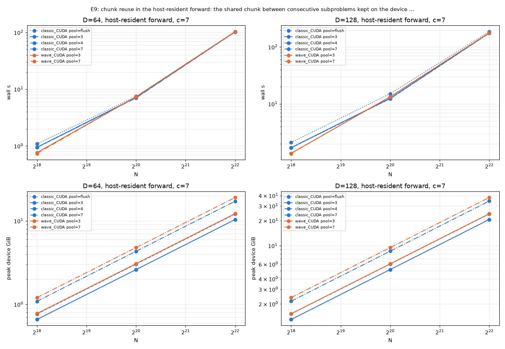

## E8: the v3 default: Q/K/V on the device with the accumulator in host memory (what attention() picks from 1M up) against E1's device accumulator at the same N (time cost vs device memory saved)

| N | D | dtype | dir | c | itr | acc | qkv | W | arm | engine that ran | wall s | min s | peak GiB | workspace | host GiB | /FA-2 | /SDPA | ref | rel vs ref | grads | fp64 (x ref) | fp64 dq (x ref) | status |
|---|---|---|---|---|---|---|---|---|---|---|---|---|---|---|---|---|---|---|---|---|---|---|---|
| 512K | 64 | fp16 | fwd | 7 | min | cpu | device | - | classic_CUDA | classic/cuda itr=1 n_sub=7 | 1.923 | 1.923 | 2.81 | 1.30 | 3.43 | 1.300 | 1.235 | - | - | - | 2.0e-05 | - | ok |
| 512K | 64 | fp16 | fwd | 7 | min | cpu | device | - | wave_CUDA | wave/cuda itr=1 n_sub=7 waves=7 | 1.992 | 1.992 | 3.05 | 1.54 | 4.35 | 1.346 | 1.279 | - | - | - | 2.0e-05 | - | ok |
| 512K | 64 | fp16 | bwd | 7 | min | cpu | device | - | classic_CUDA | classic/cuda itr=1 n_sub=7 | 6.336 | 6.336 | 5.69 | 3.68 | 6.81 | 1.209 | 1.127 | - | - | - | 2.0e-05 | 3.6e-04 | ok |
| 512K | 64 | fp16 | bwd | 7 | min | cpu | device | - | wave_CUDA | wave/cuda itr=1 n_sub=7 waves=7 | 5.388 | 5.388 | 10.00 | 7.99 | 0.04 | 1.028 | 0.958 | - | - | - | 2.0e-05 | 3.6e-04 | ok |
| 1M | 64 | fp16 | fwd | 7 | min | cpu | device | - | classic_CUDA | classic/cuda itr=1 n_sub=7 | 6.758 | 6.758 | 5.61 | 2.60 | 7.83 | 1.120 | 1.069 | - | - | - | 1.6e-05 | - | ok |
| 1M | 64 | fp16 | fwd | 7 | min | cpu | device | - | wave_CUDA | wave/cuda itr=1 n_sub=7 waves=7 | 6.855 | 6.855 | 6.08 | 3.07 | 8.43 | 1.137 | 1.085 | - | - | - | 1.6e-05 | - | ok |
| 1M | 64 | fp16 | bwd | 7 | min | cpu | device | - | classic_CUDA | classic/cuda itr=1 n_sub=7 | 23.082 | 23.082 | 11.37 | 7.36 | 14.30 | 1.098 | 1.022 | - | - | - | 1.6e-05 | 4.9e-04 | ok |
| 1M | 64 | fp16 | bwd | 7 | min | cpu | device | - | wave_CUDA | wave/cuda itr=1 n_sub=7 waves=7 | 21.158 | 21.158 | 19.99 | 15.98 | 0.08 | 1.006 | 0.937 | - | - | - | 1.6e-05 | 4.9e-04 | ok |
| 2M | 64 | fp16 | fwd | 7 | min | cpu | device | - | classic_CUDA | classic/cuda itr=1 n_sub=7 | 24.719 | 24.719 | 11.20 | 5.19 | 13.64 | 1.013 | 0.968 | - | - | - | 1.5e-05 | - | ok |
| 2M | 64 | fp16 | fwd | 7 | min | cpu | device | - | wave_CUDA | wave/cuda itr=1 n_sub=7 waves=7 | 25.497 | 25.497 | 12.14 | 6.13 | 16.69 | 1.045 | 0.999 | - | - | - | 1.5e-05 | - | ok |
| 2M | 64 | fp16 | bwd | 7 | min | cpu | device | - | classic_CUDA | classic/cuda itr=1 n_sub=7 | 87.921 | 87.921 | 22.71 | 14.71 | 28.35 | 1.045 | 0.975 | - | - | - | 1.5e-05 | 8.0e-04 | ok |
| 2M | 64 | fp16 | bwd | 7 | min | cpu | device | - | wave_CUDA | wave/cuda itr=1 n_sub=7 waves=7 | 84.208 | 84.208 | 39.95 | 31.94 | 0.15 | 1.001 | 0.934 | - | - | - | 1.5e-05 | 8.0e-04 | ok |
| 4M | 64 | fp16 | fwd | 7 | min | cpu | device | - | classic_CUDA | classic/cuda itr=1 n_sub=7 | 95.494 | 95.494 | 22.38 | 10.37 | 26.84 | 0.978 | 0.937 | - | - | - | 1.9e-05 | - | ok |
| 4M | 64 | fp16 | fwd | 7 | min | cpu | device | - | wave_CUDA | wave/cuda itr=1 n_sub=7 waves=7 | 98.871 | 98.871 | 24.28 | 12.27 | 32.78 | 1.012 | 0.970 | - | - | - | 1.9e-05 | - | ok |
| 4M | 64 | fp16 | bwd | 7 | min | cpu | device | - | classic_CUDA | classic/cuda itr=1 n_sub=7 | 344.529 | 344.529 | 45.42 | 29.41 | 52.48 | 1.020 | 0.948 | - | - | - | 1.9e-05 | 1.4e-03 | ok |
| 4M | 64 | fp16 | bwd | 7 | min | cpu | device | - | wave_CUDA | wave/cuda itr=4 n_sub=2401 waves=2401 | 380.069 | 380.069 | 76.26 | 60.25 | 5.24 | 1.125 | 1.046 | - | - | - | 7.8e-06 | 1.4e-03 | ok |

Host accumulator (E8) vs device accumulator (E1), Q/K/V on the device, c=7, the planner's depth:

| arm | N | dir | E1 wall s (itr) | E8 wall s (itr) | E8/E1 | E1 dev GiB | E8 dev GiB | saved | E8 host GiB (VmHWM) | E8 acc ran |
|---|---|---|---|---|---|---|---|---|---|---|
| classic_CUDA | 512K | bwd | 5.31 (1) | 6.34 (1) | 1.193 | 9.54 | 5.69 | 40% | 6.8 (8.0) | cpu |
| classic_CUDA | 1M | bwd | 20.88 (1) | 23.08 (1) | 1.105 | 19.06 | 11.37 | 40% | 14.3 (15.5) | cpu |
| classic_CUDA | 2M | bwd | 83.08 (1) | 87.92 (1) | 1.058 | 38.12 | 22.71 | 40% | 28.4 (29.5) | cpu |
| classic_CUDA | 4M | bwd | 340.95 (2) | 344.53 (1) | 1.011 | 64.13 | 45.42 | 29% | 52.5 (53.7) | cpu |
| wave_CUDA | 512K | bwd | 5.40 (1) | 5.39 (1) | 0.997 | 10.00 | 10.00 | 0% | 0.0 (1.3) | gpu |
| wave_CUDA | 1M | bwd | 21.13 (1) | 21.16 (1) | 1.001 | 19.99 | 19.99 | 0% | 0.1 (1.3) | gpu |
| wave_CUDA | 2M | bwd | 83.85 (1) | 84.21 (1) | 1.004 | 39.95 | 39.95 | 0% | 0.2 (1.4) | gpu |
| wave_CUDA | 4M | bwd | 379.99 (4) | 380.07 (4) | 1.000 | 76.26 | 76.26 | 0% | 5.2 (6.4) | gpu |
| classic_CUDA | 512K | fwd | 1.48 (1) | 1.92 (1) | 1.300 | 4.75 | 2.81 | 41% | 3.4 (4.5) | cpu |
| classic_CUDA | 1M | fwd | 5.85 (1) | 6.76 (1) | 1.155 | 9.49 | 5.61 | 41% | 7.8 (8.9) | cpu |
| classic_CUDA | 2M | fwd | 23.30 (1) | 24.72 (1) | 1.061 | 18.97 | 11.20 | 41% | 13.6 (14.7) | cpu |
| classic_CUDA | 4M | fwd | 92.67 (1) | 95.49 (1) | 1.031 | 37.93 | 22.38 | 41% | 26.8 (27.9) | cpu |
| wave_CUDA | 512K | fwd | 1.54 (1) | 1.99 (1) | 1.291 | 5.22 | 3.05 | 42% | 4.3 (5.4) | cpu |
| wave_CUDA | 1M | fwd | 6.03 (1) | 6.85 (1) | 1.136 | 10.43 | 6.08 | 42% | 8.4 (9.5) | cpu |
| wave_CUDA | 2M | fwd | 23.98 (1) | 25.50 (1) | 1.063 | 20.84 | 12.14 | 42% | 16.7 (17.8) | cpu |
| wave_CUDA | 4M | fwd | 96.16 (1) | 98.87 (1) | 1.028 | 41.68 | 24.28 | 42% | 32.8 (33.9) | cpu |

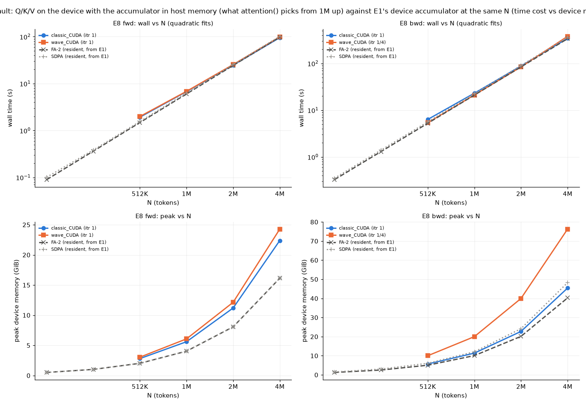
